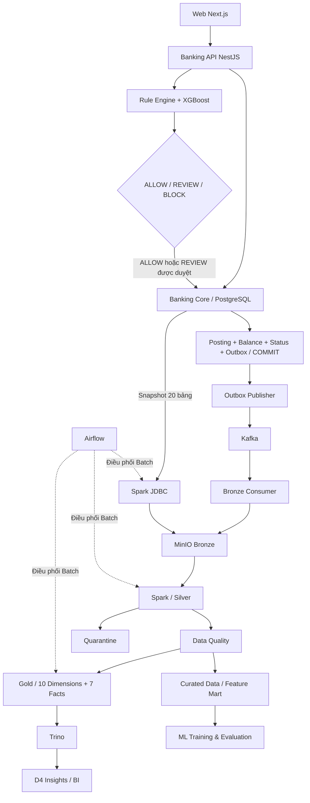

# D4 Bank — Banking Transaction Fraud Detection & Data Platform

**Nền tảng mô phỏng ngân hàng tích hợp phát hiện gian lận và phân tích dữ liệu.**

D4 Bank kết nối toàn bộ hành trình của một giao dịch: khách hàng gửi yêu cầu chuyển tiền, hệ thống đánh giá rủi ro bằng Rule Engine và Machine Learning, ngân hàng xử lý tiền, sau đó dữ liệu được đưa vào nền tảng phân tích qua Batch và Realtime.

Dự án kết hợp ba lĩnh vực: **ứng dụng ngân hàng**, **phát hiện gian lận**, và **Data Engineering**. Giao diện phục vụ khách hàng, nhân viên và quản trị viên; dữ liệu nghiệp vụ được lưu trong PostgreSQL, còn dữ liệu phân tích được tổ chức trên MinIO theo mô hình Bronze → Silver → Gold.

## Mục lục

- [Chức năng chính](#chức-năng-chính)
- [Kiến trúc hệ thống](#kiến-trúc-hệ-thống)
- [Công nghệ sử dụng](#công-nghệ-sử-dụng)
- [Luồng giao dịch ngân hàng](#luồng-giao-dịch-ngân-hàng)
- [Phát hiện gian lận](#phát-hiện-gian-lận)
- [Nền tảng dữ liệu](#nền-tảng-dữ-liệu)
- [Mô hình dữ liệu phân tích](#mô-hình-dữ-liệu-phân-tích)
- [Cấu trúc mã nguồn](#cấu-trúc-mã-nguồn)
- [Cài đặt và chạy](#cài-đặt-và-chạy)
- [API và các dịch vụ](#api-và-các-dịch-vụ)
- [Kiểm thử](#kiểm-thử)
- [Nguyên tắc thiết kế](#nguyên-tắc-thiết-kế)

## Chức năng chính

### Khách hàng

- Đăng nhập và quản lý hồ sơ cá nhân.
- Xem tài khoản, số dư, thẻ và lịch sử giao dịch.
- Chuyển tiền với xác minh người nhận và OTP qua email.
- Theo dõi kết quả giao dịch và xem biên nhận.
- Tra cứu khoản vay, lịch trả nợ và trạng thái từng kỳ.
- Quản lý thiết bị, đổi mật khẩu, đổi PIN thẻ và xem thông báo.

### Nhân viên ngân hàng

- Tra cứu khách hàng, tài khoản, thẻ, khoản vay và giao dịch trong phạm vi chi nhánh.
- Thực hiện chuyển khoản tại quầy sau khi xác minh yêu cầu của khách hàng.
- Xử lý các nghiệp vụ nạp/rút tiền và quản lý tài khoản.
- Kiểm tra giao dịch cần duyệt, đưa ra quyết định chấp thuận hoặc từ chối.
- Quản lý khoản vay và ghi nhận nhãn gian lận phục vụ phân tích, Machine Learning.

### Quản trị viên

- Theo dõi hoạt động ngân hàng qua dashboard tổng quan.
- Quản lý chi nhánh, nhân viên và tài khoản hệ thống.
- Tra cứu giao dịch rủi ro và nhật ký thao tác.
- Xem báo cáo trên dữ liệu Gold qua Trino tại khu vực D4 Insights.

### Xử lý dữ liệu và Machine Learning

- Kết hợp Rule Engine với mô hình XGBoost để đánh giá giao dịch.
- Phát sự kiện đã commit bằng Transactional Outbox và Kafka.
- Thu thập dữ liệu từ PostgreSQL và Kafka vào MinIO.
- Chuẩn hóa, kiểm tra chất lượng và đưa dữ liệu không hợp lệ vào Quarantine.
- Xây dựng 10 bảng chiều và 7 bảng sự kiện phục vụ phân tích.
- Lập lịch pipeline bằng Airflow; lưu dữ liệu và kết quả kiểm tra theo từng batch.

## Kiến trúc hệ thống



Hệ thống có ba vùng trách nhiệm:

| Vùng | Trách nhiệm |
|---|---|
| **Banking Core** | Kiểm tra nghiệp vụ, khóa tài khoản, debit/credit, cập nhật số dư, trạng thái và outbox |
| **Risk/Fraud** | Tính điểm rule, dự đoán xác suất gian lận và quyết định ALLOW/REVIEW/BLOCK |
| **Data Platform** | Kafka, thu thập dữ liệu, xử lý Spark, điều phối Airflow, lưu trữ MinIO và phân tích Trino |

**COMMIT là ranh giới giữa giao dịch ngân hàng và nền tảng dữ liệu.** Một giao dịch đã commit không bị đảo ngược vì Kafka, Spark, MinIO hoặc Airflow tạm ngừng hoạt động.

## Công nghệ sử dụng

| Thành phần | Công nghệ | Vai trò |
|---|---|---|
| Giao diện | Next.js, React, TypeScript, Tailwind CSS | Không gian làm việc cho ba nhóm người dùng |
| Biểu đồ và dữ liệu giao diện | ECharts, TanStack Query | Trực quan hóa, tải và quản lý cache dữ liệu |
| Backend | NestJS, TypeScript | API, xác thực, phân quyền và điều phối nghiệp vụ |
| Cơ sở dữ liệu nghiệp vụ | PostgreSQL, PL/pgSQL | Lưu dữ liệu, thực thi nghiệp vụ và bảo đảm transaction |
| Xác thực | JWT, Redis | Phiên đăng nhập, OTP và giới hạn tần suất yêu cầu |
| Email | Brevo | Gửi OTP và thông báo giao dịch |
| Phát hiện gian lận | Python, XGBoost, scikit-learn, joblib | Dự đoán xác suất gian lận |
| Realtime | Apache Kafka | Truyền sự kiện sau commit |
| Data Lake | MinIO, Parquet | Lưu dữ liệu Bronze, Silver, Gold và Quarantine |
| Xử lý dữ liệu | Apache Spark / PySpark | Trích xuất, biến đổi, kiểm tra và xây dựng dữ liệu phân tích |
| Điều phối | Apache Airflow | Lập lịch, retry và theo dõi từng bước Batch |
| Truy vấn phân tích | Trino, Hive Metastore | Truy vấn các bảng và view Gold |
| Triển khai | Docker Compose | Đóng gói và kết nối các dịch vụ |

## Luồng giao dịch ngân hàng

Ví dụ một khách hàng chuyển tiền từ tài khoản A sang tài khoản B:

1. Khách hàng chọn tài khoản nguồn, nhập số tài khoản nhận và số tiền.
2. API xác minh thông tin người nhận; khách hàng xác nhận giao dịch bằng OTP.
3. Hệ thống lấy dữ liệu hành vi trước giao dịch, chạy Rule Engine và model XGBoost.
4. Decision Engine quyết định **ALLOW**, **REVIEW** hoặc **BLOCK**.
5. Giao dịch ALLOW, hoặc REVIEW đã được nhân viên duyệt, đi vào xử lý tài chính.
6. PostgreSQL khóa tài khoản và kiểm tra lại quyền giao dịch, trạng thái tài khoản, số dư.
7. Posting debit/credit, thay đổi số dư, trạng thái thành công và sự kiện outbox được ghi trong cùng transaction.
8. Sau commit, publisher chuyển sự kiện tới Kafka để hệ thống dữ liệu tiếp nhận.

| Quyết định | Cách xử lý |
|---|---|
| **ALLOW** | Được phép bước vào xử lý tài chính |
| **REVIEW** | Chờ nhân viên kiểm tra; chỉ xử lý tài chính sau APPROVE |
| **BLOCK** | Dừng yêu cầu, không tạo posting tài chính |

**ALLOW không đồng nghĩa với SUCCESS.** Ví dụ, giao dịch có rủi ro thấp vẫn có thể thất bại vì tài khoản không đủ số dư khi được khóa và kiểm tra lại.

API dùng `idempotencyKey` để nhận diện các lần gửi lại cùng một yêu cầu. PostgreSQL kiểm tra nội dung yêu cầu và giữ việc retry không tạo thêm một lần chuyển tiền.

## Phát hiện gian lận

### Rule Engine

Sáu rule tạo điểm rủi ro theo chính sách V1:

| Rule | Điều kiện | Điểm |
|---|---|---:|
| R01 — HIGH_AMOUNT | Số tiền từ 50.000.000 VND | +20 |
| R02 — NEW_DEVICE | Thiết bị mới hoặc chưa được tin cậy | +20 |
| R03 — UNUSUAL_TIME | Giao dịch từ 00:00 đến trước 05:00 | +10 |
| R04 — HIGH_VELOCITY | Có ít nhất 5 giao dịch trong cửa sổ 10 phút | +25 |
| R05 — FAILED_LOGIN | Có ít nhất 5 lần đăng nhập thất bại/bị chặn trong 30 phút | +15 |
| R06 — AMOUNT_ANOMALY | Số tiền từ 5 lần mức trung bình 30 ngày | +20 |

`RuleScore` là tổng điểm các rule được kích hoạt, tối đa 100.

| RuleScore | RiskLevel |
|---|---|
| 0–39 | LOW |
| 40–59 | MEDIUM |
| 60–79 | HIGH |
| 80–100 | CRITICAL |

### Machine Learning

Model online là pipeline **XGBoost** tại [`models/fraud_detection_model.joblib`](models/fraud_detection_model.joblib), đi kèm [`models/model_metadata.json`](models/model_metadata.json).

Model sử dụng **19 feature** thuộc các nhóm:

- Thông tin giao dịch: số tiền, kênh và loại giao dịch.
- Thời gian: giờ, ngày trong tuần và giao dịch ban đêm.
- Tài khoản: số ngày từ khi mở tài khoản.
- Hành vi giao dịch: tần suất trong 1 giờ, 24 giờ, 7 ngày, 30 ngày; mức tiền trung bình, lớn nhất và khoảng cách giữa các giao dịch.
- Đăng nhập: số lần thành công, thất bại và tỷ lệ thất bại.

API giữ một worker Python để cache model trong bộ nhớ. Feature được lấy trước giao dịch; xác suất, danh tính artifact và feature snapshot được liên kết với kết quả đánh giá để truy vết.

Notebook phục vụ chuẩn bị dữ liệu, huấn luyện và đánh giá nằm trong [`notebooks/`](notebooks/). Các module trong [`ml/`](ml/) phục vụ inference và vòng đời artifact; bộ trainer JSON/logistic được giữ riêng cho nghiên cứu, tách với model joblib online.

### Decision Engine

```text
Nếu ModelProbability >= 0.90 hoặc RuleScore >= 80 → BLOCK
Nếu ModelProbability >= 0.60 hoặc RuleScore >= 60 → REVIEW
Các trường hợp còn lại                         → ALLOW
```

BLOCK được xét trước REVIEW. Xác suất model và điểm rule được lưu riêng trong `risk_assessment`, cùng model version và thông tin giải thích.

## Nền tảng dữ liệu

### Batch: từ PostgreSQL đến Gold

```text
PostgreSQL — cùng một snapshot cho 20 bảng
    → Spark JDBC
    → Bronze
    → Bronze Data Quality
    → Silver / Quarantine
    → Silver Data Quality
    → Gold
    → Gold Data Quality
    → Publish release trên Trino
```

V1 sử dụng **full snapshot nhất quán** cho 20 bảng nguồn. Các reader cùng nhìn một trạng thái PostgreSQL, giúp giữ quan hệ giữa giao dịch, posting, risk và các bảng tham chiếu.

DAG [`banking_bronze_silver_gold`](airflow/dags/banking_data_pipeline.py) chạy lúc **01:00 hằng ngày theo giờ Việt Nam**. Airflow điều phối; logic xử lý nằm trong các module Spark. Mỗi stage có thể retry độc lập.

### Realtime: từ Outbox đến Bronze

```text
Giao dịch COMMIT → EVENT_OUTBOX → Publisher → Kafka → Consumer → Bronze
```

Publisher chỉ đọc sự kiện đã commit. Consumer lưu và kiểm tra object trên MinIO trước khi commit Kafka offset.

Cơ chế truyền là **at-least-once**: sự kiện có thể được gửi lại khi retry. Bronze giữ dữ liệu để audit/replay; các bước xử lý sau sử dụng khóa sự kiện để deduplicate.

Các trang nghiệp vụ trên web đọc PostgreSQL qua API. Kafka cung cấp dữ liệu sự kiện cho Data Platform; khi bật `ENABLE_REALTIME_SILVER_MERGE`, Batch tạo thêm dataset `domain_event` để phân tích và đối soát. Các bảng Silver nghiệp vụ lấy PostgreSQL Batch làm nguồn chuẩn.

### Vai trò của các lớp dữ liệu

| Lớp | Nội dung và mục đích |
|---|---|
| **Bronze** | Dữ liệu nguồn và metadata thu thập, phục vụ audit và replay |
| **Silver** | Dữ liệu đã chuẩn hóa, kiểm tra và deduplicate theo khóa nghiệp vụ |
| **Quarantine** | Record không hợp lệ kèm dữ liệu gốc và lý do để đối soát |
| **Gold** | Dimensions, facts và view phục vụ báo cáo, dashboard |
| **Pipeline Control** | Metadata batch, kết quả các stage và thông tin release |

Silver và Gold được tổ chức theo **release của từng batch**. Gold đọc Silver đã qua DQ của đúng batch; sau khi Gold đạt kiểm tra, hệ thống publish release cho analytics. Chạy lại cùng batch giữ tính idempotent và không nhân bản dữ liệu phân tích.

## Mô hình dữ liệu phân tích

PostgreSQL có **29 bảng nghiệp vụ**. Data Platform chọn **20 bảng nguồn** theo [`config/sources.yaml`](config/sources.yaml) để xây dựng Gold gồm **10 dimensions và 7 facts**.

**Dimension** mô tả đối tượng dùng để phân tích; **fact** lưu các sự kiện và số đo nghiệp vụ.

| Dimensions | Mô tả |
|---|---|
| `dim_date`, `dim_time` | Ngày và thời gian |
| `dim_customer`, `dim_account` | Khách hàng và tài khoản |
| `dim_account_type`, `dim_branch` | Loại tài khoản và chi nhánh |
| `dim_transaction_type`, `dim_channel` | Loại giao dịch và kênh |
| `dim_device`, `dim_model` | Thiết bị và phiên bản model |

| Facts | Một dòng đại diện cho |
|---|---|
| `fact_transaction` | Một giao dịch ngân hàng |
| `fact_transaction_posting` | Một posting debit hoặc credit |
| `fact_risk_assessment` | Một lần đánh giá rủi ro |
| `fact_fraud_review` | Một hồ sơ kiểm tra giao dịch |
| `fact_fraud_label_event` | Một sự kiện gán nhãn gian lận |
| `fact_login_event` | Một sự kiện đăng nhập |
| `fact_loan_payment` | Một lần thanh toán khoản vay |

Trino cung cấp các view tổng hợp theo giao dịch, rủi ro, review, model, đăng nhập và trả nợ. D4 Insights sử dụng release Gold để hiển thị dữ liệu phân tích nhất quán trong cùng một lần tải dashboard.

## Cấu trúc mã nguồn

```text
.
├── web/                    # Giao diện Next.js cho customer, employee, admin
├── backend/                # NestJS API, OTP, phân quyền, publisher, email worker
├── sql/                    # Schema, functions, views, triggers và Trino SQL
├── streaming/              # Kafka consumer ghi dữ liệu Bronze
├── data_engineering/
│   ├── ingestion/batch/    # PostgreSQL snapshot → Bronze
│   ├── bronze/             # Kiểm tra dữ liệu raw
│   ├── silver/             # Chuẩn hóa, validate, deduplicate
│   ├── quality/            # DQ và Quarantine
│   ├── gold/               # Build dimensions, facts và release
│   ├── common/             # Config, contracts, Spark, pipeline state
│   └── jobs/               # Điểm chạy các stage
├── airflow/dags/           # DAG điều phối Batch
├── ml/                     # Inference và quản lý artifact
├── models/                 # Model joblib và metadata
├── notebooks/              # Chuẩn bị dữ liệu, huấn luyện và đánh giá
├── config/                 # Source mapping và quy tắc Data Quality
├── scripts/                # Bootstrap, kiểm tra và công cụ vận hành
├── tests/                  # Python, SQL và integration tests
├── docker/                 # Dockerfiles và cấu hình dịch vụ
├── docs/                   # Tài liệu hướng dẫn chi tiết
├── docker-compose.yaml     # Khai báo các dịch vụ
└── .env.example            # Mẫu cấu hình local
```

Các file `sql/z_*.sql` là phần thực thi nghiệp vụ. NestJS gọi function `banking_api.*` đã cài trong PostgreSQL, ví dụ `create_transfer`, `resolve_review` và `pay_loan`. Backend quản lý transaction và context của request; PostgreSQL thực hiện các thao tác tài chính bên trong transaction đó.

## Cài đặt và chạy

### 1. Chuẩn bị

- Git.
- Docker Engine hoặc Docker Desktop, kèm Docker Compose V2.
- Node.js 22 và npm để chạy giao diện trên máy.
- Khuyến nghị ít nhất **8 GB RAM trống** cho toàn bộ stack.
- Python 3.11 cho các script chạy trên máy và kiểm thử Python.

Với Windows/WSL, bật WSL integration trong Docker Desktop trước khi chạy lệnh Docker.

```bash
git clone https://github.com/dien-2006/banking-transaction-fraud-detection.git
cd banking-transaction-fraud-detection
```

### 2. Cấu hình môi trường

Tạo `.env` nếu máy chưa có file cấu hình:

```bash
test -f .env || cp .env.example .env
```

Điền các nhóm thông tin phù hợp với môi trường:

| Nhóm | Biến tiêu biểu |
|---|---|
| PostgreSQL | `POSTGRES_DB`, `POSTGRES_USER`, `POSTGRES_PASSWORD`, `POSTGRES_PORT` |
| API và phiên đăng nhập | `JWT_SECRET`, `CORS_ORIGINS`, `BANKING_API_PORT` |
| OTP và email | `REDIS_URL`, `OTP_HASH_SECRET`, `BREVO_API_KEY`, `OTP_SENDER_EMAIL` |
| MinIO | `MINIO_ROOT_USER`, `MINIO_ROOT_PASSWORD`, các biến `MINIO_BUCKET_*` |
| Airflow | `AIRFLOW_DB_PASSWORD`, `AIRFLOW_ADMIN_USERNAME`, `AIRFLOW_ADMIN_PASSWORD`, `AIRFLOW_ADMIN_EMAIL` |
| Kafka | `KAFKA_CLUSTER_ID`, `KAFKA_TRANSACTION_TOPIC` |
| Trả nợ | `LOAN_SETTLEMENT_ACCOUNT_ID`: ID tài khoản INTERNAL dùng nhận tiền trả nợ |

OTP sử dụng email khách hàng trong database và sender đã được xác minh trên Brevo. Các tài khoản PostgreSQL, MinIO và Airflow dùng giá trị do người triển khai cấu hình.

Các file `.env.banking`, `.env.outbox`, `.env.notification`, `.env.etl` phục vụ cấu hình theo service. Compose chọn chúng qua các biến `BANKING_ENV_FILE`, `OUTBOX_ENV_FILE`, `NOTIFICATION_ENV_FILE`, `ETL_ENV_FILE`; mặc định đọc `.env`.

### 3. Khởi động các dịch vụ

```bash
docker compose up -d --build
docker compose ps -a
```

Trên PostgreSQL volume mới, init script tạo schema từ `sql/create_table.sql`, sau đó nạp các file `z_*.sql`. Bootstrap đăng ký model và tạo customer, tài khoản, thiết bị demo. Compose cũng khởi động các thành phần Batch và trigger `bootstrap_first_run` của DAG.

Database và volume đã tồn tại được giữ lại. Tài khoản đăng nhập web nằm trong `customer_online_account` hoặc `system_user`; sử dụng tài khoản đã được cấp trong database của môi trường triển khai.

Theo dõi quá trình khởi động:

```bash
docker compose logs -f banking-api airflow-scheduler
```

### 4. Chạy giao diện

Tạo `web/.env.local` với địa chỉ API:

```env
NEXT_PUBLIC_API_URL=http://localhost:8000
```

Ở terminal riêng:

```bash
cd web
npm ci
npm run dev
```

Mở **http://localhost:3000**. Sau đăng nhập, hệ thống chuyển người dùng tới không gian làm việc tương ứng với vai trò.

### 5. Bật Realtime

```bash
docker compose --profile realtime up -d --build
```

Profile này khởi động cụm Kafka 3 broker, tạo topic, chạy outbox publisher, Bronze consumer và Kafka UI. Với cụm mới có thể tạo cluster ID bằng:

```bash
docker run --rm confluentinc/cp-kafka:7.9.0 kafka-storage random-uuid
```

Đặt ID vào `KAFKA_CLUSTER_ID` trước khi khởi tạo cụm. Với cụm đã có dữ liệu, giữ nguyên ID đang sử dụng.

### 6. Chạy Batch theo yêu cầu

Ngoài lịch hằng ngày, có thể tạo một lượt chạy mới:

```bash
docker compose exec airflow-webserver airflow dags trigger banking_bronze_silver_gold
```

Xem lịch sử và log:

```bash
docker compose exec airflow-webserver airflow dags list-runs -d banking_bronze_silver_gold
docker compose logs -f airflow-scheduler spark-master spark-worker
```

### 7. Dừng và chạy lại

```bash
docker compose --profile realtime stop
docker compose --profile realtime up -d
```

`stop` giữ lại dữ liệu và volume để tiếp tục sử dụng ở lần chạy sau.

## API và các dịch vụ

Các địa chỉ dưới đây dùng cổng mặc định trong Compose:

| Dịch vụ | Địa chỉ |
|---|---|
| Web | http://localhost:3000 |
| API Swagger | http://localhost:8000/docs |
| API health | http://localhost:8000/api/v1/health |
| Kafka UI | http://localhost:8080 |
| Airflow | http://localhost:8081 |
| Spark Master UI | http://localhost:8082 |
| Trino HTTP | http://localhost:8084 |
| MinIO API | http://localhost:9000 |
| MinIO Console | http://localhost:9001 |
| PostgreSQL | `localhost:5432` |

API nghiệp vụ có prefix **`/api/v1`**. Các nhóm endpoint chính:

| Nhóm | Ví dụ | Mục đích |
|---|---|---|
| Xác thực | `POST /auth/login` | Đăng nhập và nhận JWT |
| Khách hàng | `GET /me/accounts`, `GET /me/loans` | Tra cứu dữ liệu của người dùng |
| OTP | `POST /security/otp/request`, `POST /security/otp/verify` | Xác minh giao dịch |
| Chuyển tiền | `POST /transactions/transfers` | Chuyển khoản online |
| Tại quầy | `POST /transactions/counter-transfers` | Chuyển khoản do nhân viên thực hiện |
| Review | `POST /transactions/reviews/:id` | APPROVE hoặc REJECT giao dịch |
| Quản lý | `/management/*` | Thao tác trên các đối tượng nghiệp vụ |
| Dashboard | `/admin/*` | Tổng quan và tra cứu theo quyền |
| Analytics | `GET /analytics/snapshot` | Dữ liệu Gold cho dashboard phân tích |

Sau khi đăng nhập, gửi JWT trong header:

```http
Authorization: Bearer <access-token>
```

Luồng chuyển khoản online gồm ba request dùng cùng thông tin giao dịch: yêu cầu OTP → xác minh OTP → tạo transfer với `otpAuthorizationToken`. Swagger cung cấp mô tả API để tra cứu và thử request.

## Kiểm thử

### Python

Từ thư mục gốc, dùng môi trường Python 3.11:

```bash
python -m pip install -r requirements.txt
python -m pytest -q
```

Để chạy thêm worker inference thật, cài dependency đã pin:

```bash
python -m pip install -r docker/requirements-inference.txt
```

### Backend

```bash
cd backend
npm ci
npm run typecheck
npm run test:web
```

### Frontend

```bash
cd web
npm ci
npm run typecheck
npm run test:web
npm run build
```

### Integration và end-to-end

PostgreSQL integration tests dùng database thử riêng có tên bắt đầu bằng `d4_`, đã nạp schema và function. Sau khi cấu hình các biến kết nối tới database thử:

```bash
RUN_BANKING_INTEGRATION=1 python -m pytest -q tests/integration
```

Tests bao phủ risk boundary, idempotency, posting/rollback, review, snapshot và phân quyền runtime. Các bài kiểm tra cần Redis hoặc worker joblib được bật riêng bằng `RUN_REDIS_INTEGRATION=1` và `RUN_JOBLIB_INTEGRATION=1` trong môi trường test backend.

Để kiểm chứng toàn tuyến API → PostgreSQL → Outbox → Kafka → Bronze → Batch → Trino, sử dụng [`scripts/e2e_test.py`](scripts/e2e_test.py). Script yêu cầu `E2E_ACCESS_TOKEN` của admin/nhân viên và `E2E_ALLOW_DEMO_TRANSFER=1`, vì bài kiểm tra tạo một giao dịch demo có commit thật.

## Nguyên tắc thiết kế

- **PostgreSQL là nguồn dữ liệu nghiệp vụ chuẩn.** ETL và ML sử dụng contract schema hiện có.
- **ALLOW khác SUCCESS.** Chỉ kết quả xử lý tài chính mới quyết định trạng thái thành công.
- **Debit/credit nguyên tử.** Posting, số dư, trạng thái và success outbox cùng nằm trong transaction.
- **Sự kiện đi qua Transactional Outbox.** Kafka nhận sự kiện sau commit.
- **Bronze giữ raw; Silver chuẩn hóa; Gold phục vụ phân tích.** Dữ liệu không hợp lệ đi vào Quarantine.
- **Retry và replay có định danh.** Request key, event key và batch/release giúp kiểm soát duplicate và truy vết.
- **Model artifact nằm ngoài PostgreSQL.** Database lưu danh tính phiên bản và kết quả đánh giá; API cache model để inference.

Các quy tắc đóng góp và invariant của hệ thống được mô tả trong [`AGENTS.md`](AGENTS.md).
