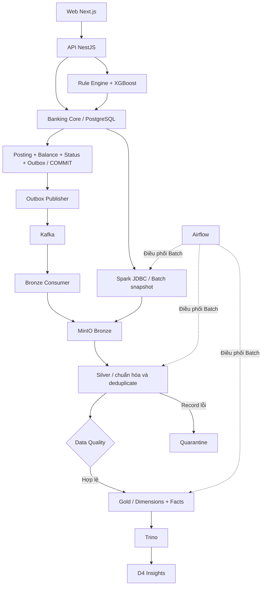

# D4 Bank — Banking, Fraud Detection & Data Platform

D4 Bank là dự án mô phỏng ngân hàng, kết hợp **giao dịch tài chính**, **phát hiện gian lận bằng Rule Engine và Machine Learning**, và **nền tảng dữ liệu phục vụ phân tích**.

Dự án theo dõi một giao dịch từ lúc khách hàng chuyển tiền, qua kiểm soát rủi ro và hạch toán, đến khi dữ liệu xuất hiện trong báo cáo. PostgreSQL lưu dữ liệu nghiệp vụ; Kafka, Spark, MinIO, Airflow và Trino đảm nhiệm việc thu thập, xử lý và phân tích dữ liệu.

Ứng dụng có ba vai trò: **khách hàng**, **nhân viên ngân hàng** và **quản trị viên**. Các chức năng thẻ, QR và chuyển khoản mô phỏng hoạt động trong D4 Bank; chưa tích hợp mạng thanh toán liên ngân hàng thực tế.

## Bắt đầu từ đâu?

| Bạn muốn làm gì? | Tài liệu / phần cần đọc |
| --- | --- |
| Hiểu dự án và luồng giao dịch | [Chức năng](#chức-năng-chính), [Kiến trúc](#kiến-trúc-hệ-thống), [Luồng lưu trữ](#một-giao-dịch-được-xử-lý-và-lưu-như-thế-nào) |
| Clone và cài lần đầu | [Cài đặt và chạy](#cài-đặt-và-chạy), hướng dẫn chi tiết tại [running.md](running.md) |
| Cập nhật code trên EC2 đã có DB | [Cập nhật trên EC2](#cập-nhật-code-trên-ec2) |
| Tìm hiểu ETL, Kafka và dữ liệu phân tích | [Data Platform](#data-platform), [mô hình Gold](#mô-hình-dữ-liệu-gold) |
| Tra cứu API hoặc sửa từng module | [Công nghệ và cấu trúc repository](#công-nghệ-và-cấu-trúc-repository), [backend](backend/README.md), [frontend](web/README.md) |
| Kiểm tra lỗi vận hành | [running.md — Kiểm tra và xử lý lỗi](running.md#8-kiểm-tra-và-xử-lý-lỗi) |

## Chức năng chính

| Vai trò | Chức năng |
| --- | --- |
| **Khách hàng** | Đăng ký/kích hoạt đăng nhập qua OTP email; xem số dư và lịch sử; chuyển tiền; tạo/đọc QR nhận tiền; mở tài khoản, đăng ký thẻ và khoản vay; trả nợ; quản lý hồ sơ, thiết bị và thông báo. |
| **Nhân viên** | Quản lý khách hàng, tài khoản, thẻ và khoản vay trong phạm vi chi nhánh; chuyển tiền, nạp/rút tại quầy; xử lý review; phê duyệt và giải ngân khoản vay. |
| **Quản trị viên** | Xem dữ liệu toàn hệ thống; quản lý chi nhánh, nhân viên và tài khoản hệ thống; giám sát Fraud & Review, nhật ký hoạt động và báo cáo D4 Insights. |

Khách hàng mới đăng ký chỉ có hồ sơ và tài khoản đăng nhập; tài khoản ngân hàng được mở riêng. Khách hàng đã có hồ sơ tại chi nhánh dùng trang `/activate` để kích hoạt đăng nhập cho đúng hồ sơ đó.

Nhân viên chỉ truy cập dữ liệu trong phạm vi được cấp quyền. Quản trị viên xem toàn bộ chi nhánh và có thể lọc theo chi nhánh. API kiểm tra quyền ở backend cho cả thao tác đọc và ghi.

### Khoản vay và phạm vi Risk/ML

- Chuyển tiền thông thường do khách hàng thực hiện được kiểm tra bằng Rule Engine và model.
- Nghiệp vụ của nhân viên/admin, giải ngân và trả nợ vay không chạy Rule Engine hoặc model; vẫn kiểm tra quyền, tài khoản, số dư và điều kiện nghiệp vụ.
- Phê duyệt khoản vay chỉ kích hoạt hợp đồng và tạo lịch trả nợ khi giải ngân **thành công**. Tiền được ghi có vào tài khoản khách hàng đã chọn.
- Chứng từ giải ngân được giữ trong DB để truy vết và chống cộng tiền trùng, nhưng được ẩn khỏi lịch sử giao dịch thông thường trên web.
- Khi kết quả chưa xác định do lỗi mạng, thử lại cùng mã yêu cầu để đối chiếu; không tạo lệnh mới cho cùng một thao tác.

## Kiến trúc hệ thống



| Thành phần | Trách nhiệm |
| --- | --- |
| **Banking Core** | Validation, khóa tài khoản, hạch toán, cập nhật số dư, trạng thái và Outbox. |
| **Risk/Fraud** | Tính điểm luật, lấy xác suất model và quyết định `ALLOW / REVIEW / BLOCK`. |
| **Data Platform** | Thu thập dữ liệu đã commit, xử lý Batch/Realtime, kiểm tra chất lượng và phục vụ báo cáo. |

**COMMIT là ranh giới giữa nghiệp vụ ngân hàng và Data Platform.** Kafka, Spark, MinIO hoặc Airflow không phải điều kiện để một giao dịch ngân hàng commit thành công.

## Một giao dịch được xử lý và lưu như thế nào?

Với chuyển khoản online, khách hàng chọn tài khoản nguồn, xác minh người nhận, xác nhận thông tin và xác thực OTP. API sau đó kiểm tra rủi ro và xử lý yêu cầu trong DB transaction.

| Bước | Bảng chính | Dữ liệu / hành động |
| --- | --- | --- |
| Tạo yêu cầu | `bank_transaction`, `transfer_request` | Lưu giao dịch, tài khoản nguồn/nhận và khóa chống gửi trùng. |
| Đánh giá rủi ro | `risk_assessment` | Lưu RuleScore, xác suất ML, mức rủi ro, quyết định và thông tin giải thích. |
| Chờ kiểm tra nếu REVIEW | `review_case` | Lưu hồ sơ để nhân viên phê duyệt hoặc từ chối; chưa hạch toán. |
| Xử lý tài chính khi được phép | `transaction_posting`, `bank_account` | Khóa tài khoản, kiểm tra lại số dư, ghi nợ/ghi có và cập nhật số dư. |
| Ghi kết quả | `bank_transaction` | Cập nhật trạng thái thực tế của giao dịch. |
| Ghi sự kiện và nhật ký | `event_outbox`, `audit_log` | Lưu sự kiện nghiệp vụ và dấu vết thay đổi theo các thao tác được cấu hình audit. |
| Sau commit | Kafka → MinIO Bronze | Producer phát sự kiện; consumer lưu dữ liệu để xử lý tiếp. |

Các bản ghi chỉ được lưu bền vững khi DB transaction commit. Lỗi trước commit phải rollback các thay đổi trong transaction đó.

### Phân biệt các bảng và trạng thái

| Bảng | Ý nghĩa |
| --- | --- |
| `bank_transaction` | Lưu cả giao dịch thành công, thất bại, bị hủy và đang chờ. Phân biệt bằng `Success / Failed / Cancelled / Pending`. |
| `transaction_posting` | Lưu bút toán `DEBIT / CREDIT`. Tổng ghi nợ phải bằng tổng ghi có; giao dịch chưa thành công không được có bút toán đã commit. |
| `event_outbox` | Lưu sự kiện cần gửi sang Kafka. Trạng thái `PENDING / PUBLISHED / FAILED` mô tả việc gửi sự kiện. |
| `notification_outbox` | Lưu thông báo cần gửi cho khách hàng. Trạng thái `PENDING / SENT / FAILED` mô tả việc gửi thông báo. |

Ví dụ, giao dịch có thể là `Success` trong `bank_transaction` nhưng sự kiện có trạng thái `FAILED` trong `event_outbox` vì Kafka chưa nhận được. Producer sẽ retry gửi sự kiện; không thực hiện lại việc chuyển tiền.

**ALLOW không đồng nghĩa với SUCCESS.** Sau khi vượt kiểm soát rủi ro, giao dịch vẫn có thể thất bại vì không đủ số dư. Chỉ `ALLOW` hoặc `REVIEW` đã được phê duyệt mới được đi vào xử lý tài chính.

## Phát hiện gian lận

### Rule Engine V1

| Rule | Điều kiện | Điểm |
| --- | --- | ---: |
| R01 — HIGH_AMOUNT | Số tiền từ 50.000.000 VND | +20 |
| R02 — NEW_DEVICE | Thiết bị mới hoặc chưa được tin cậy | +20 |
| R03 — UNUSUAL_TIME | Từ 00:00 đến trước 05:00 | +10 |
| R04 — HIGH_VELOCITY | Ít nhất 5 giao dịch trong 10 phút trước giao dịch hiện tại | +25 |
| R05 — FAILED_LOGIN | Ít nhất 5 lần đăng nhập thất bại/bị chặn trong 30 phút | +15 |
| R06 — AMOUNT_ANOMALY | Số tiền từ 5 lần mức trung bình giao dịch thành công trong 30 ngày | +20 |

Tổng điểm được giới hạn ở 100. Mức rủi ro theo RuleScore: `LOW` 0–39, `MEDIUM` 40–59, `HIGH` 60–79, `CRITICAL` 80–100.

### Model và quyết định

Model online là **XGBoost**, gồm [artifact Joblib](models/fraud_detection_model.joblib) và [metadata](models/model_metadata.json). Model sử dụng **19 feature** về giao dịch, thời gian, tuổi tài khoản, lịch sử giao dịch và đăng nhập. Backend giữ worker Python để cache model trong bộ nhớ.

Decision Engine kết hợp hai tín hiệu và xét BLOCK trước REVIEW:

```text
ModelProbability >= 0.90 hoặc RuleScore >= 80 → BLOCK
ModelProbability >= 0.60 hoặc RuleScore >= 60 → REVIEW
Còn lại                                    → ALLOW
```

| Quyết định | Kết quả xử lý |
| --- | --- |
| `ALLOW` | Chuyển sang kiểm tra và xử lý tài chính. |
| `REVIEW` | Tạo hồ sơ chờ nhân viên kiểm tra; chỉ hạch toán sau khi được phê duyệt. |
| `BLOCK` | Hủy giao dịch, không hạch toán. Cảnh báo hiển thị tại Fraud & Review dù không có hồ sơ review. |

Các [notebook](notebooks/) phục vụ chuẩn bị dữ liệu, huấn luyện và đánh giá; [module ML](ml/) phục vụ inference và quản lý artifact. Model binary nằm ngoài PostgreSQL; DB lưu danh tính phiên bản và kết quả đánh giá.

Để tương thích điều kiện hạch toán của DB hiện có, nghiệp vụ không chạy Risk/ML lưu dấu cho phép `BUSINESS_POLICY` với `risk_evaluated=false`, `model_evaluated=false`. Các giá trị số 0 bắt buộc trong DB là giá trị tương thích, không phải dự đoán; API hiển thị các trường đó là chưa đánh giá.

## Data Platform

### Batch: PostgreSQL → Gold

```text
Snapshot PostgreSQL → Spark JDBC → Bronze → Bronze DQ
→ Silver / Quarantine → Silver DQ → Gold → Gold DQ → Publish Trino
```

Phiên bản hiện tại lấy **full snapshot nhất quán của 20 bảng nguồn**, khai báo tại [config/sources.yaml](config/sources.yaml). DAG [banking_bronze_silver_gold](airflow/dags/banking_data_pipeline.py) chạy lúc **01:00 hằng ngày, giờ Việt Nam**. Airflow điều phối; các module Spark thực hiện transformation.

### Realtime: Outbox → Bronze

```text
Giao dịch COMMIT → EVENT_OUTBOX → Producer → Kafka → Consumer → MinIO Bronze
```

Consumer chỉ commit Kafka offset sau khi dữ liệu đã được ghi bền vững. Luồng sử dụng **at-least-once delivery**, nên cùng một sự kiện có thể đến nhiều lần. Bronze giữ dữ liệu raw để audit/replay; dữ liệu chuẩn hóa được deduplicate theo khóa xác định.

Realtime hiện thu thập đến Bronze. Khi bật `ENABLE_REALTIME_SILVER_MERGE`, Batch tạo thêm dataset `domain_event` để phân tích/đối soát; các bảng Silver nghiệp vụ vẫn lấy PostgreSQL Batch làm nguồn chuẩn. Stream không tự cập nhật số dư hoặc thay nguồn dữ liệu của các trang nghiệp vụ.

| Lớp dữ liệu | Mục đích |
| --- | --- |
| **Bronze** | Giữ dữ liệu nguồn và metadata thu thập để audit/replay. |
| **Silver** | Chuẩn hóa kiểu dữ liệu, kiểm tra và loại bản trùng theo quy tắc xác định. |
| **Quarantine** | Giữ record lỗi cùng dữ liệu gốc và lý do để đối soát. |
| **Gold** | Cung cấp dimensions và facts phục vụ phân tích. |

Silver/Gold được tổ chức theo batch/release. Gold chỉ được publish sau khi vượt kiểm tra chất lượng; chạy lại cùng input phải giữ tính idempotent.

### Mô hình dữ liệu Gold

PostgreSQL có **29 bảng nghiệp vụ**. Gold gồm **10 dimensions và 7 facts**:

| Nhóm dimensions | Bảng |
| --- | --- |
| Thời gian | `dim_date`, `dim_time` |
| Khách hàng và tài khoản | `dim_customer`, `dim_account`, `dim_account_type` |
| Tổ chức và giao dịch | `dim_branch`, `dim_transaction_type`, `dim_channel` |
| Thiết bị và model | `dim_device`, `dim_model` |

| Fact | Một dòng đại diện cho |
| --- | --- |
| `fact_transaction` | Một giao dịch ngân hàng. |
| `fact_transaction_posting` | Một bút toán ghi nợ hoặc ghi có. |
| `fact_risk_assessment` | Một lần đánh giá rủi ro. |
| `fact_fraud_review` | Một hồ sơ review. |
| `fact_fraud_label_event` | Một sự kiện gán nhãn gian lận. |
| `fact_login_event` | Một sự kiện đăng nhập. |
| `fact_loan_payment` | Một lần thanh toán khoản vay. |

[Trino views](sql/trino/gold_analytics.sql) tổng hợp giao dịch, risk, review, model, đăng nhập và trả nợ. D4 Insights đọc dữ liệu Gold qua Trino; dashboard nghiệp vụ đọc PostgreSQL qua API.

## Công nghệ và cấu trúc repository

| Phần hệ thống | Công nghệ |
| --- | --- |
| Giao diện | Next.js, React, TypeScript, Tailwind CSS, ECharts |
| API và xác thực | NestJS, JWT, Redis, OTP email qua Brevo |
| Banking Core | PostgreSQL, SQL functions, views, triggers, Transactional Outbox |
| Machine Learning | Python, XGBoost, Joblib |
| Realtime | Kafka, KafkaJS, Python consumer |
| Batch và lưu trữ | Spark, Airflow, MinIO, Parquet |
| Truy vấn phân tích | Trino, Hive Metastore |
| Đóng gói và web gateway | Docker Compose, Caddy |

```text
web/                    Giao diện cho khách hàng, nhân viên và admin
backend/                API, phân quyền, OTP, producer và worker email
sql/                    Schema, functions, views, triggers và Trino SQL
streaming/              Kafka consumer ghi Bronze
data_engineering/       Ingestion, Silver, DQ, Quarantine và Gold
airflow/dags/           DAG điều phối Batch
ml/                     Inference và quản lý artifact
models/                 Model online và metadata
notebooks/              Chuẩn bị dữ liệu, huấn luyện và đánh giá
config/                 Source mapping và cấu hình Data Quality
pipeline_control/       Quản lý trạng thái pipeline và release
scripts/                Công cụ khởi tạo, kiểm tra và vận hành
tests/                  Kiểm thử Python, SQL và integration
docker/                 Dockerfiles và cấu hình container
running.md              Hướng dẫn cài đặt và vận hành chi tiết
```

Backend kết hợp phân quyền và logic ứng dụng với các function `banking_api.*` đã cài trong PostgreSQL. Các thao tác tài chính cốt lõi vẫn tuân theo transaction, locking và kiểm tra tính toàn vẹn trong DB.

## Cài đặt và chạy

### Cài mới

Cần **Git**, **Docker Engine + Docker Compose V2** và **Python 3** để chạy script vận hành. Dùng Python 3.11 cho inference; Node.js 22 khi chạy npm trực tiếp trên máy. Các dependency của ứng dụng được đóng gói trong Dockerfile.

```bash
git clone https://github.com/dien-2006/banking-transaction-fraud-detection.git
cd banking-transaction-fraud-detection
test -f .env || cp .env.example .env
```

Sau khi clone:

1. Điền `.env` theo môi trường: PostgreSQL, JWT/OTP secrets, email; thêm MinIO/Airflow/Kafka nếu bật Data Platform. Không commit `.env`.
2. Bật DB và Redis: `docker compose up -d postgres-bank redis`.
3. Với **DB trống**, dùng DBeaver nạp schema, dữ liệu mẫu nếu cần, views/functions/triggers theo đúng thứ tự trong [running.md — Khởi tạo hoặc khôi phục DB](running.md#2-khởi-tạo-hoặc-khôi-phục-db--chỉ-làm-khi-cần). Với DB đã khôi phục đủ từ backup, giữ nguyên dữ liệu hiện có.
4. Chuẩn bị runtime roles và model theo [running.md — Cấp quyền runtime và kiểm tra model](running.md#3-cấp-quyền-runtime-và-kiểm-tra-model). API cần model ACTIVE khớp artifact đang sử dụng.
5. Khi DB, cấu hình và model đã sẵn sàng, bật web/API:

```bash
python3 -m scripts.check_web_deployment
docker compose --profile web build banking-api web
docker compose --profile web up -d postgres-bank redis banking-api web gateway notification-sender
docker compose --profile web ps
```

Docker **không tự nạp schema hoặc dữ liệu nghiệp vụ** khi khởi động. Tài khoản đăng nhập dùng dữ liệu đã được cấp trong DB hoặc luồng đăng ký/kích hoạt của ứng dụng.

Web Docker truy cập qua gateway tại `http://localhost`, hoặc IP/domain đã cấu hình bằng `PUBLIC_HOST`. Cổng `3000` dành cho frontend chạy bằng npm; container web không public trực tiếp cổng này.

### Phát triển frontend trên máy

Khi DB, Redis và API đã sẵn sàng:

```bash
cd web
npm ci
NEXT_PUBLIC_API_URL=http://localhost:8000 npm run dev
```

Mở `http://localhost:3000`; đặt `CORS_ORIGINS` của API tương ứng. Xem [hướng dẫn frontend local](running.md#5-chạy-local-để-phát-triển-giao-diện) nếu cần chuẩn bị backend.

### Cập nhật code trên EC2

Chạy tại thư mục dự án sau khi code đã được push lên nhánh đang triển khai và DB/cấu hình hiện tại đã hoạt động:

```bash
git pull --ff-only
docker compose --profile web build banking-api web &&
docker compose --profile web up -d --no-deps banking-api web notification-sender

docker compose --profile web ps
docker compose logs --tail=100 banking-api web notification-sender
```

Các thay đổi chỉ ở README hoặc `.gitignore` không cần rebuild. Cập nhật code không phải bước tạo lại DB: không chạy lại `create_table.sql` hoặc seed trên DB đang có dữ liệu. Nếu một bản cập nhật yêu cầu đổi SQL function, làm theo hướng dẫn riêng của bản đó trước khi triển khai.

Các lệnh trên cập nhật nhóm web/API. Nếu sửa producer, consumer hoặc job ETL, cập nhật thêm đúng service tương ứng đang sử dụng.

### Bật Data Platform khi cần

Web/API có thể chạy độc lập với nhóm phân tích. Hướng dẫn bật từng nhóm nằm trong [running.md — Các nhóm tùy chọn](running.md#7-các-nhóm-tùy-chọn):

| Nhu cầu | Thành phần |
| --- | --- |
| Xem Gold đã có trên D4 Insights | MinIO, Hive Metastore, Trino và Gold release hợp lệ. |
| Chạy Batch ETL | Nhóm trên cùng Spark và Airflow. |
| Thu thập sự kiện liên tục | Kafka, Outbox Publisher, Bronze Consumer và MinIO. |

Khi Airflow đã chạy, có thể yêu cầu một lượt Batch mới:

```bash
docker compose exec airflow-webserver airflow dags trigger banking_bronze_silver_gold
```

## Địa chỉ truy cập và API

Các cổng dưới đây là mặc định trên máy chạy Docker; chỉ truy cập được khi service tương ứng đã bật.

| Dịch vụ | Địa chỉ mặc định |
| --- | --- |
| Web qua gateway | `http://localhost` hoặc domain đã cấu hình |
| Frontend npm dev | `http://localhost:3000` |
| Swagger | `http://127.0.0.1:8000/docs` |
| API health | `http://127.0.0.1:8000/api/v1/health` |
| Kafka UI | `http://localhost:8080` |
| Airflow | `http://localhost:8081` |
| Spark Master UI | `http://localhost:8082` |
| Trino | `http://127.0.0.1:8084` |
| MinIO Console | `http://localhost:9001` |
| MinIO API | `http://localhost:9000` |
| PostgreSQL | `127.0.0.1:5432` |

Trên EC2, truy cập DB và dashboard nội bộ qua SSH tunnel. Web được phục vụ qua gateway HTTP/HTTPS; các cổng có thể thay đổi trong `.env`.

API nghiệp vụ dùng prefix `/api/v1`. Các nhóm chính: `/auth`, `/me`, `/security/otp`, `/transactions`, `/management`, `/admin` và `/analytics`. Request đã đăng nhập gửi `Authorization: Bearer <access-token>`; Swagger mô tả từng endpoint.

## Kiểm thử và nguyên tắc đóng góp

Chạy từ thư mục gốc; các nhóm kiểm thử có thể chạy độc lập khi đã cài dependency tương ứng:

```bash
# Backend: typecheck, build và kiểm thử hợp đồng API/nghiệp vụ
(cd backend && npm ci && npm run typecheck && npm run test:web)

# Frontend: typecheck và kiểm thử dữ liệu/giao diện
(cd web && npm ci && npm run typecheck && npm run test:web)

# Python: các kiểm thử không yêu cầu hạ tầng được bật riêng
python3 -m pip install -r requirements.txt
python3 -m pytest -q
```

Kiểm thử trình duyệt cần Playwright/Chromium và web thử nghiệm; xem [web/README.md](web/README.md). PostgreSQL integration tests cần **database thử riêng** và cờ `RUN_BANKING_INTEGRATION=1`. Script [e2e_test.py](scripts/e2e_test.py) có tạo giao dịch demo thật nên yêu cầu opt-in rõ ràng; xem hướng dẫn trước khi chạy.

Khi đóng góp, tạo nhánh `feature/*`, `fix/*` hoặc `data/*`, kiểm tra thay đổi và mở PR. Giữ các nguyên tắc:

- Không tự thay schema PostgreSQL; mọi thay đổi phải giữ contract dữ liệu hiện tại.
- Chỉ `Success` sau khi hạch toán hợp lệ; giữ tính nguyên tử của posting, số dư, trạng thái và Outbox.
- Phát sự kiện sau commit; retry phải giữ định danh và không nhân đôi thao tác tài chính.
- Giữ raw ở Bronze, đưa record lỗi vào Quarantine và giữ Gold idempotent.
- Không commit mật khẩu, token, OTP hoặc dữ liệu truy cập môi trường thật.
