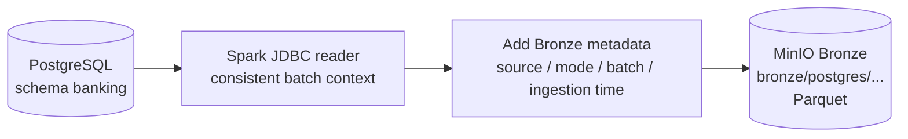
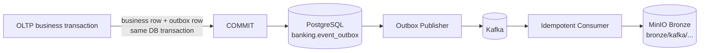
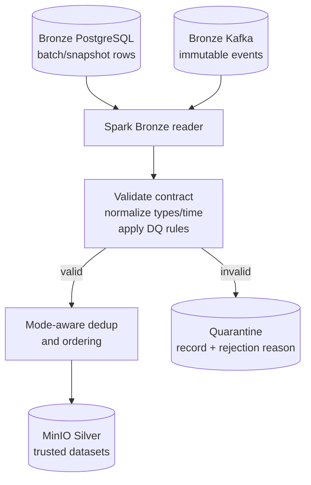

# Batch + Streaming Ingestion Design

Ngày thiết kế: 2026-09-28

Trạng thái: **DESIGNED ONLY** — không có pipeline, publisher, consumer, Spark job hoặc DAG nào được implement trong TASK 02.

## 1. Phạm vi và căn cứ

Thiết kế này dựa trên:

- `docs/architecture/current_state.md` của TASK 01;
- DDL `sql/create_table.sql`;
- metadata read-only của PostgreSQL runtime;
- dữ liệu read-only trong `banking.event_outbox` để xác định event đang thực sự tồn tại.

Phạm vi source được chọn là 22 bảng nghiệp vụ mà yêu cầu TASK 02 ưu tiên. Không mặc định ingest 7 bảng còn lại (`role`, `employee`, `system_user`, `customer_online_account`, `card`, `notification_outbox`, `audit_log`) vì chưa có use case ETL hiện tại, một số chứa authentication secret/PII, và chúng không nằm trong danh sách ưu tiên. Việc loại khỏi mapping hiện tại không đồng nghĩa được xóa khỏi source.

## 2. Ba luồng logical

### 2.1 Batch ingestion



Batch là đường bắt buộc cho full historical load và snapshot/reconciliation. Spark là processing engine; Airflow sau này chỉ orchestration.

### 2.2 Streaming ingestion



Publisher/consumer chỉ là target design. Source code hiện không tồn tại; Kafka runtime hiện cũng không healthy.

### 2.3 Unified processing



“Unified” nghĩa Silver dùng chung schema/rules theo domain, không có nghĩa batch và stream ghi mù vào cùng path hoặc stream được phép ghi đè snapshot khi thiếu ordering/version.

## 3. Quy ước load strategy

- `FULL → INCREMENTAL`: run đầu đọc toàn bộ; run sau chỉ đọc insert mới bằng watermark kép và overlap/reconciliation. Chỉ dùng cho bảng có tính event/history append-only sau khi đặc tính này được test.
- `FULL → SNAPSHOT`: run đầu full; run sau đọc snapshot đầy đủ vì record có thể update nhưng schema không có change signal đáng tin cậy. Snapshot mới không xóa vật lý snapshot cũ trong Bronze.
- Mọi watermark chỉ được lưu sau run SUCCESS. Giá trị timestamp luôn đi cùng PK tie-breaker, không dùng timestamp đơn lẻ.
- Runtime PostgreSQL đang dùng `Asia/Ho_Chi_Minh`, nhưng source column là `timestamp without time zone`. Bronze phải ghi source timezone trong metadata; Silver mới chuyển về UTC. Đây là runtime contract, không phải datatype guarantee trong DDL.

## 4. Batch source mapping

Logical dataset name dùng namespace `bronze_postgres_banking.<table>` và `silver.<table>`. Physical paths ở mục 7.

| Source table | PK | Business key thực tế | Timestamp/date columns | Candidate watermark | Strategy | Bronze → Silver | Dedup key | Partition strategy |
|---|---|---|---|---|---|---|---|---|
| `bank_transaction` | `transactionid` | `transactioncode` UNIQUE | `transactiondate` | `(transactiondate, transactionid)` chỉ bắt insert | FULL → SNAPSHOT vì `status` có thể đổi | same table namespaced → `silver.bank_transaction` | `transactionid`; kiểm tra `transactioncode` unique | Bronze `_ingest_date/_batch_id`; Silver `transaction_date` |
| `transfer_request` | `transferrequestid` | `transactionid` UNIQUE; `idempotencykey` UNIQUE | `requestedat` | `(requestedat, transferrequestid)` chỉ bắt insert | FULL → SNAPSHOT vì `status` mutable | → `silver.transfer_request` | `transferrequestid`; validate 2 unique keys | Bronze batch partitions; Silver `requested_date` |
| `transaction_posting` | `postingid` | Không có business UNIQUE khác PK | `postingdate` | `(postingdate, postingid)` | FULL → INCREMENTAL, cần xác nhận append-only | → `silver.transaction_posting` | `postingid` | Bronze batch partitions; Silver `posting_date` |
| `transaction_type` | `transactiontypeid` | `typecode`, `typename` UNIQUE | Không có | Không có | FULL → SNAPSHOT | → `silver.transaction_type` | `transactiontypeid`; validate code/name unique | Bronze batch partitions; Silver unpartitioned current |
| `customer` | `customerid` | `customercode` UNIQUE; `nationalid` nullable UNIQUE | `createddate` | `(createddate, customerid)` chỉ bắt insert | FULL → SNAPSHOT vì profile/status mutable | → `silver.customer` | `customerid`; validate business uniques | Bronze batch partitions; Silver unpartitioned current |
| `customer_device` | `deviceid` | `devicecode` UNIQUE; `(customerid,deviceid)` UNIQUE | `firstseenat`, `lastseenat` | `lastseenat` không bao phủ mọi mutation | FULL → SNAPSHOT | → `silver.customer_device` | `deviceid`; validate `devicecode` | Bronze batch partitions; Silver unpartitioned current |
| `login_event` | `logineventid` | Không có | `logintime` | `(logintime, logineventid)` | FULL → INCREMENTAL, cần xác nhận append-only | → `silver.login_event` | `logineventid` | Bronze batch partitions; Silver `login_date` |
| `bank_account` | `accountid` | `accountnumber` UNIQUE | `opendate`, `createdat`, `updatedat` | `(COALESCE(updatedat,createdat),accountid)` chỉ khi app bảo đảm `updatedat` | FULL → SNAPSHOT | → `silver.bank_account` | `accountid`; validate account number | Bronze batch partitions; Silver unpartitioned current |
| `account_holder` | `accountholderid` | Active `(accountid,customerid)` partial UNIQUE; một active primary owner/account | `startdate`, `enddate` | Không có change timestamp | FULL → SNAPSHOT | → `silver.account_holder` | `accountholderid`; validate partial uniqueness | Bronze batch partitions; Silver unpartitioned current |
| `account_type` | `accounttypeid` | `typename` UNIQUE | Không có | Không có | FULL → SNAPSHOT | → `silver.account_type` | `accounttypeid`; validate `typename` | Bronze batch partitions; Silver unpartitioned current |
| `account_status_history` | `historyid` | Không có | `changeddate` | `(changeddate, historyid)` | FULL → INCREMENTAL, cần xác nhận append-only | → `silver.account_status_history` | `historyid` | Bronze batch partitions; Silver `changed_date` |
| `branch` | `branchid` | `branchcode` UNIQUE | `opendate`, `createdat` | `(createdat,branchid)` chỉ bắt insert | FULL → SNAPSHOT vì status/attributes mutable | → `silver.branch` | `branchid`; validate code unique | Bronze batch partitions; Silver unpartitioned current |
| `terminal` | `terminalid` | `terminalcode` UNIQUE | Không có | Không có | FULL → SNAPSHOT | → `silver.terminal` | `terminalid`; validate code unique | Bronze batch partitions; Silver unpartitioned current |
| `risk_assessment` | `riskassessmentid` | Không có; nhiều assessment/transaction được phép | `assessedat` | `(assessedat, riskassessmentid)` | FULL → INCREMENTAL, cần xác nhận append-only | → `silver.risk_assessment` | `riskassessmentid` | Bronze batch partitions; Silver `assessed_date` |
| `review_case` | `reviewcaseid` | Không có; nhiều case/transaction được phép | `createdat`, `reviewedat` | Không reliable vì status có thể đổi độc lập | FULL → SNAPSHOT | → `silver.review_case` | `reviewcaseid` | Bronze batch partitions; Silver `created_date` nếu lưu history; current unpartitioned |
| `fraud_label_event` | `fraudlabeleventid` | Không có; nhiều label event/transaction được phép | `labeledat` | `(labeledat, fraudlabeleventid)` | FULL → INCREMENTAL, cần xác nhận append-only | → `silver.fraud_label_event` | `fraudlabeleventid` | Bronze batch partitions; Silver `labeled_date` |
| `model_version` | `modelversionid` | Không có UNIQUE ngoài PK; `modelname` không unique | `createdat` | `(createdat,modelversionid)` chỉ bắt insert, không bắt status | FULL → SNAPSHOT | → `silver.model_version` | `modelversionid` | Bronze batch partitions; Silver unpartitioned current |
| `loan` | `loanid` | `loancode` UNIQUE | `startdate`, `enddate` | Không có change timestamp | FULL → SNAPSHOT vì status/terms có thể đổi | → `silver.loan` | `loanid`; validate code unique | Bronze batch partitions; Silver unpartitioned current |
| `loan_type` | `loantypeid` | `loantypename` UNIQUE | Không có | Không có | FULL → SNAPSHOT | → `silver.loan_type` | `loantypeid`; validate name unique | Bronze batch partitions; Silver unpartitioned current |
| `repayment_schedule` | `scheduleid` | `(loanid,installmentno)` UNIQUE | `duedate` | Không có change timestamp | FULL → SNAPSHOT vì status/penalty mutable | → `silver.repayment_schedule` | `scheduleid`; validate installment unique | Bronze batch partitions; Silver unpartitioned current |
| `loan_payment` | `loanpaymentid` | `transactionid` UNIQUE | `paymentdate` | `(paymentdate,loanpaymentid)` | FULL → INCREMENTAL, cần xác nhận append-only | → `silver.loan_payment` | `loanpaymentid`; validate transaction unique | Bronze batch partitions; Silver `payment_date` |
| `event_outbox` | `eventoutboxid` | `eventkey` UNIQUE | `createdat`, `publishedat` | `(createdat,eventoutboxid)` chỉ bắt event mới | FULL → SNAPSHOT cho trạng thái batch; publisher dùng stream riêng | → `silver.event_outbox` | `eventoutboxid`, `eventkey` | Bronze batch partitions; Silver `created_date` |

### 4.1 Incremental candidates

Candidates mạnh nhất về mặt schema/semantics: `transaction_posting`, `login_event`, `account_status_history`, `risk_assessment`, `fraud_label_event`, `loan_payment`. Chúng có identity PK và event timestamp, nhưng DDL không cấm UPDATE/DELETE; cần test/application contract trước khi gọi là reliable incremental.

`event_outbox` hỗ trợ đọc event mới bằng `(createdat,eventoutboxid)`, nhưng batch incremental này sẽ bỏ qua thay đổi `status/publishedat`; do đó mapping trạng thái outbox vẫn là SNAPSHOT.

### 4.2 Snapshot candidates

`bank_transaction`, `transfer_request`, `transaction_type`, `customer`, `customer_device`, `bank_account`, `account_holder`, `account_type`, `branch`, `terminal`, `review_case`, `model_version`, `loan`, `loan_type`, `repayment_schedule`, `event_outbox`.

## 5. EVENT_OUTBOX capabilities thực tế

### 5.1 Physical contract hiện có

| Capability | Source field/constraint | Kết luận |
|---|---|---|
| Source PK | `eventoutboxid BIGINT IDENTITY PRIMARY KEY` | Có; dùng audit/tie-breaker, không thay event ID public |
| Event identifier | `eventkey VARCHAR(100) NOT NULL UNIQUE` | Có; phù hợp idempotency key/event ID |
| Aggregate type | `aggregatetype VARCHAR(50) NOT NULL` | Có |
| Aggregate/entity ID | `aggregateid VARCHAR(100) NOT NULL` | Có, nhưng string và không có FK/type constraint |
| Event type | `eventtype VARCHAR(100) NOT NULL` | Có |
| Payload | `payloadjson JSONB NOT NULL` | Có, nhưng không có schema/version constraint |
| Creation timestamp | `createdat TIMESTAMP NOT NULL DEFAULT CURRENT_TIMESTAMP` | Có; timestamp không timezone |
| Publish state | `status`, default `PENDING`, CHECK `PENDING/PUBLISHED/FAILED` | Có |
| Published timestamp | `publishedat TIMESTAMP NULL`, CHECK không trước `createdat` | Có |
| Retry count/error/next retry | Không có | **SCHEMA GAP** |
| Claim/lease/worker metadata | Không có | **SCHEMA GAP** cho multi-worker coordination/observability |
| Event version/schema version | Không có | **SCHEMA GAP** |
| Business occurred time | Không có field riêng | **SCHEMA GAP**; `createdat` chỉ chắc chắn là thời điểm ghi outbox |
| Correlation/causation/trace | Không có | **SCHEMA GAP** |
| Per-aggregate sequence/version | Không có | **SCHEMA GAP** cho deterministic merge/order |

### 5.2 Event thực sự quan sát được

Read-only inspection ngày 2026-09-28:

- 250 rows; 250 PK và 250 `eventkey` distinct.
- Chỉ có `aggregatetype='BANK_TRANSACTION'` và `eventtype='TransactionRiskAssessed'`.
- 236 `PUBLISHED`, 14 `FAILED`; published timestamp nhất quán với status trong sample hiện tại.
- Payload của toàn bộ 250 rows là object chỉ có keys `transaction_id` (JSON number) và `source` (JSON string); source quan sát là `fraud-engine`.
- `aggregateid` khớp text value của payload `transaction_id` ở 250/250 rows; tất cả resolve tới `bank_transaction` và có ít nhất một `risk_assessment`.
- Source có 1,500 risk assessment trên 1,500 transaction, nhưng outbox chỉ bao phủ 250 transaction; 1,250 assessed transaction không có event outbox tương ứng. Streaming hiện tại không phải historical source đầy đủ.

Event payload hiện tập trung vào transaction đã commit; nó không tự dựng `silver.risk_assessment`. Risk canonical đến từ Batch theo contract `rulescore`, `risklevel`, `modelprobability`, `decision`; realtime event được hội tụ theo `transaction_id` để cập nhật transaction canonical mà không nhân bản.

### 5.3 Domain event candidates

Phân loại để tránh biến thiết kế thành dữ liệu giả:

| Domain/change | Trạng thái | Lý do |
|---|---|---|
| Risk assessment recorded for bank transaction | **VERIFIED CURRENT EVENT** (`TransactionRiskAssessed`) | Có rows thực tế, nhưng payload thiếu chi tiết assessment |
| Transaction created/status changed | **DESIGN CANDIDATE** | Quan trọng cho trạng thái giao dịch; chưa có event/publisher code thực tế |
| Transfer requested/status changed | **DESIGN CANDIDATE** | Theo dõi lifecycle chuyển khoản; chưa có contract thực tế |
| Successful balanced posting committed | **DESIGN CANDIDATE** | Chỉ phát sau cùng commit tài chính; chưa có contract thực tế |
| Review case created/status changed | **DESIGN CANDIDATE** | Workflow fraud review; chưa có contract thực tế |
| Fraud label recorded | **DESIGN CANDIDATE** | Ground-truth event; chưa có contract thực tế |
| Account status history recorded | **DESIGN CANDIDATE** | Phù hợp append event; chưa có contract thực tế |
| Login event recorded | **DESIGN CANDIDATE** | Phù hợp event stream; chưa có contract thực tế |
| Loan payment recorded | **DESIGN CANDIDATE** | Chỉ publish sau transaction thành công; chưa có contract thực tế |

Tên event mới, payload và version cho các design candidate **chưa được chốt**. Không được publisher suy diễn event bằng polling business tables; business service phải insert outbox row trong cùng transaction với business changes.

### 5.4 Publisher state flow theo field hiện có

```text
PENDING
  → publisher gửi Kafka
    → broker ACK: status=PUBLISHED, publishedat=<source-local timestamp>
    → lỗi: status=FAILED, publishedat giữ NULL
```

Không mark `PUBLISHED` trước broker ACK. Khoảng lỗi giữa broker ACK và PostgreSQL status update tạo khả năng publish trùng, nên consumer bắt buộc idempotent theo `eventkey`. Chính sách đưa `FAILED` trở lại retry, backoff, max attempts và dead-letter chưa thể biểu diễn bằng schema hiện có; đây là **SCHEMA GAP**, không được suy ra từ `status`.

## 6. Canonical event envelope target

### 6.1 Target logical contract

```json
{
  "event_id": "string",
  "event_type": "string",
  "event_version": "string-or-integer",
  "occurred_at": "UTC timestamp",
  "aggregate_type": "string",
  "aggregate_id": "string",
  "payload": {},
  "source": "string",
  "correlation_id": "string-or-null",
  "causation_id": "string-or-null",
  "traceparent": "string-or-null"
}
```

Đây là target contract, không phải schema đang tồn tại.

| Target field | Mapping từ `event_outbox` | Trạng thái |
|---|---|---|
| `event_id` | `eventkey` | AVAILABLE, unique/not-null |
| `event_type` | `eventtype` | AVAILABLE |
| `event_version` | Không có | **SCHEMA GAP**; không parse từ tên event |
| `occurred_at` | Không có business timestamp; `createdat` chỉ làm `outbox_created_at` | **SCHEMA GAP** |
| `aggregate_type` | `aggregatetype` | AVAILABLE |
| `aggregate_id` | `aggregateid` | AVAILABLE |
| `payload` | `payloadjson` | AVAILABLE nhưng unversioned/unvalidated |
| `source` | Chỉ xuất hiện không bắt buộc trong payload hiện tại | **CONTRACT GAP**; publisher config có thể bổ sung provenance nhưng đó không phải source field |
| `correlation_id` | Không có | **SCHEMA GAP** |
| `causation_id` | Không có | **SCHEMA GAP** |
| `traceparent` | Không có | **SCHEMA GAP** |

Transport metadata không thuộc canonical business envelope nhưng Consumer phải ghi Bronze: `_kafka_topic`, `_kafka_partition`, `_kafka_offset`, `_kafka_timestamp`, `_consumer_group`, `_ingested_at`. Publisher nên đưa `eventoutboxid` và `createdat` vào source metadata/header để audit, không giả chúng là business event version/time.

### 6.2 Delivery semantics

- Với schema hiện tại, target thực tế là **at-least-once**: publish thành công nhưng update `PUBLISHED` thất bại có thể tạo duplicate.
- Kafka key nên là `aggregateid` để giữ order tốt nhất trong một partition; `eventkey` là dedup identity.
- Consumer dedup theo `event_id`, đồng thời giữ Kafka coordinates để audit/replay.
- Không có per-aggregate sequence; `eventoutboxid` chỉ là global insertion identity và không chứng minh business ordering dưới concurrent transactions.
- Multi-publisher claim/retry/error observability chưa đủ field. Thiết kế implementation phải giải quyết mà không âm thầm coi `FAILED` là retry metadata hoàn chỉnh.

## 7. Bronze convergence

### 7.1 Physical path separation

```text
s3a://<bronze-bucket>/bronze/postgres/banking/<table>/
  ingest_date=YYYY-MM-DD/batch_id=<batch_id>/part-*.parquet

s3a://<bronze-bucket>/bronze/kafka/<configured_topic>/<event_type>/
  ingest_date=YYYY-MM-DD/hour=HH/part-*.parquet
```

`<configured_topic>` là config chưa tồn tại, không phải topic đã được chứng minh. Batch và streaming không ghi chung file/path. Object đã publish là immutable; retry cùng identity phải phát hiện object/manifest đã tồn tại thay vì append trùng mù quáng.

### 7.2 Common Bronze metadata

| Metadata | Batch | Streaming | Mục đích |
|---|---|---|---|
| `_source_system` | `banking_postgres` từ config | `banking_postgres`/publisher provenance từ config | Nguồn hệ thống; không lấy mù từ payload |
| `_source_schema` | `banking` | `banking` | Source namespace |
| `_source_table` | Tên table thật | `event_outbox` | Truy vết physical source |
| `_ingestion_mode` | `BATCH` | `STREAM` | Chọn validation/dedup branch |
| `_ingested_at` | UTC processing time | UTC consumer time | Audit ingestion |
| `_batch_id` | Required | null | Batch identity |
| `_run_id` | Required | null hoặc consumer run identity riêng | Orchestration/audit |
| `_event_id` | null | `eventkey` | Event identity |
| `_source_pk` | PK value | `eventoutboxid` | Physical row trace |
| `_source_timezone` | `Asia/Ho_Chi_Minh` từ verified config | same for outbox timestamps | Normalize timestamp without timezone |
| `_kafka_topic/partition/offset` | null | Required | Replay/dedup/audit |
| `_payload_hash` | Optional target metadata | Required target metadata | Tamper/idempotency detection |

Metadata trên là target lake contract, không phải cột PostgreSQL.

### 7.3 Silver convergence rules

1. Batch branch validates row schema against DDL, dedups PK within batch, then compares snapshot/generation as applicable.
2. Stream branch validates canonical envelope, dedups `event_id`, validates Kafka offset uniqueness and routes by `(aggregate_type,event_type,event_version)`.
3. Silver domain rows chỉ merge khi event payload có source PK, complete required columns, event version và deterministic order. Nếu không đủ, giữ ở `silver.domain_event`/quarantine tùy lỗi contract; không fabricate domain columns.
4. Event hiện tại `TransactionRiskAssessed` chỉ đủ làm generic domain-event record, không đủ merge `silver.risk_assessment`.
5. Batch snapshot là reconciliation authority cho mutable tables cho tới khi streaming contract đầy đủ và ordering được chứng minh.
6. Invalid rows/events luôn đi Quarantine với reason, source path, batch/event identity; không silently drop.

## 8. Data quality và reconciliation boundaries

- Bronze batch: row/file count, schema, PK non-null, readable Parquet, source query bounds, manifest hash.
- Bronze stream: parse envelope, `event_id` non-null/unique, payload valid JSON, Kafka coordinate uniqueness, supported contract version.
- Silver common: exact decimal, timezone normalization, enum/check constraints, PK/FK checks trong ingestion scope, sensitive-field policy.
- Financial: Success mới được posting; mỗi successful transaction phải cân bằng Debit/Credit; không tự sửa lệch.
- Cross-mode: count distinct source PK/event ID, detect duplicate semantics, late arrival, snapshot-vs-event mismatch.
- `review_case.revieweruserid` FK tới `system_user` không nằm trong ingestion scope: giữ raw ID nhưng FK DQ downstream là **SCOPE GAP** cho tới khi quyết định ingest safe projection của user/employee.

## 9. BLOCKED / SCHEMA GAP

1. Event version, true occurred time, correlation/causation/trace và per-aggregate sequence không có trong `event_outbox`.
2. Retry attempt/error/next retry/claim metadata không có; khó vận hành publisher concurrency và quan sát lỗi.
3. Event payload không có schema registry/version contract; event đang có không đủ tái dựng `risk_assessment`.
4. Mutable tables thiếu change signal đáng tin cậy; phải snapshot cho tới khi có application/CDC contract.
5. Timestamp source không timezone; runtime timezone đã verify nhưng historical provenance vẫn phải được chốt.
6. Kafka topic/partition/retention/schema compatibility chưa được chốt và Kafka runtime hiện lỗi.
7. Bảng/cột nhạy cảm cần access policy. Phạm vi hiện tại tránh authentication hashes, nhưng vẫn có PII/financial/security telemetry.

Không schema nào được sửa và không code nào được tạo trong TASK 02.
