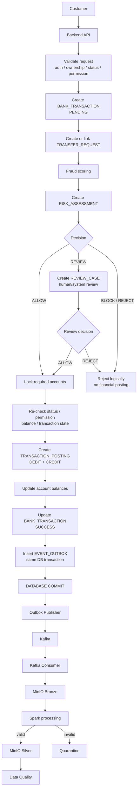
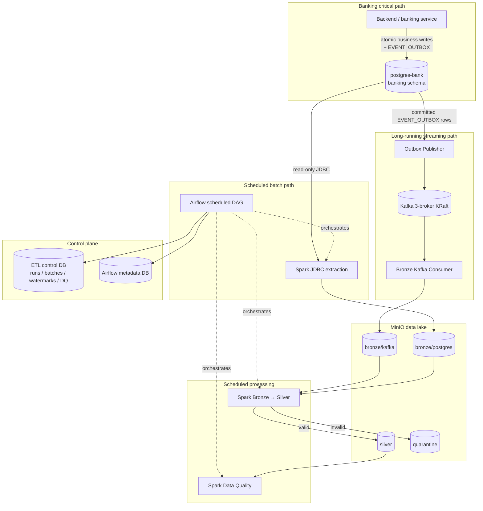
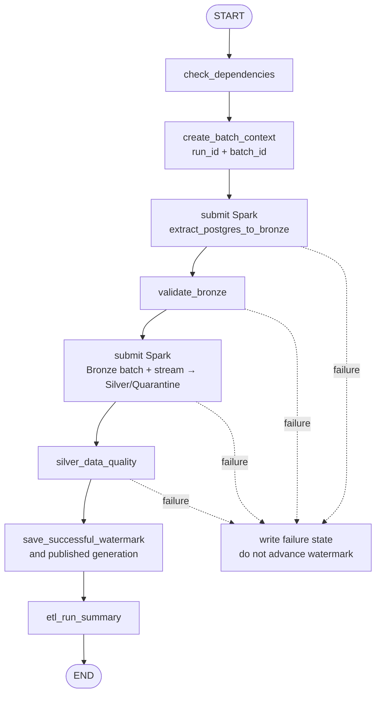

# Hybrid Data Pipeline — Target Architecture

Ngày thiết kế: 2026-09-28

Trạng thái: **DESIGNED ONLY**. TASK 03 không triển khai Docker infrastructure, không tạo service, topic, bucket, volume, network, secret, Spark job hoặc Airflow DAG.

## 1. Mục tiêu và ranh giới

Target architecture hỗ trợ đồng thời:

```text
BATCH
PostgreSQL → Spark JDBC → MinIO Bronze

STREAM
PostgreSQL → EVENT_OUTBOX → Publisher → Kafka → Consumer → MinIO Bronze

PROCESSING
MinIO Bronze → Spark → Silver / Quarantine → Data Quality

ORCHESTRATION
Airflow → scheduled Spark batch/processing/DQ jobs
```

Kafka Publisher và Consumer là long-running services. Airflow không được khởi chạy một task cho từng transaction hoặc Kafka message.

Ngoài phạm vi triển khai hiện tại:

- Gold, ML Feature Mart, Training, Fraud Model, Trino, Reporting, Dashboard và Web;
- thay đổi PostgreSQL business schema;
- transaction/backend implementation;
- exactly-once claim cho Kafka pipeline.

## 2. Source-of-truth transaction boundary

Kiến trúc data platform không được thay đổi thứ tự banking transaction. Luồng dọc bắt buộc:



`COMMIT` là ranh giới Banking System/Data Platform. Publisher chỉ đọc event đã commit. Kafka, Consumer, MinIO, Spark và Airflow không tham gia quyết định fraud, lock, balance hoặc posting.

DDL hiện tại của `bank_transaction.status` không có `Rejected`; nhánh reject trong sơ đồ là logical flow. Không được tự thêm/ánh xạ trạng thái khi chưa xử lý **BLOCKED / SCHEMA GAP** này.

## 3. Target component architecture



Batch và stream hội tụ ở logical Silver contract, không hội tụ bằng cách cùng ghi một Bronze path. Khi event thiếu source PK/version/order, stream chỉ tạo trusted generic event hoặc Quarantine; không được ghi đè snapshot.

## 4. Docker services target

Tên dưới đây là target service names, chưa tồn tại trừ khi ghi rõ “current”. Image phải pin bằng immutable version/digest; không dùng `latest` trong target deployment.

### 4.1 Data and control stores

| Service | Lifecycle | Responsibility | Persistent volume |
|---|---|---|---|
| `postgres-bank` | Long-running, current | OLTP source và `banking.event_outbox`; giữ nguyên source schema/data | Existing `postgres_bank_data`, không recreate/delete |
| `minio` | Long-running, current | Bronze, Silver, Quarantine object storage | Existing `minio_data`, bảo toàn |
| `minio-init` | One-shot target | Tạo bucket/policy/service account idempotently; không ghi business data | None |
| `postgres-airflow` | Long-running, current | Airflow metadata duy nhất | Existing `postgres_airflow_data` |
| `etl-control-db` | Long-running target | Run/batch/watermark/DQ state; tách khỏi OLTP và Airflow metadata | New `etl_control_data` |

Control database là data-platform state store, không phải thay đổi source PostgreSQL. Logical entities tối thiểu: ETL run, batch, per-dataset successful watermark, dataset publish generation và DQ result. Watermark chỉ advance sau successful publish + DQ policy.

### 4.2 Spark compute

| Service | Lifecycle | Responsibility |
|---|---|---|
| `spark-master` | Long-running | Spark Standalone control plane; không chứa dữ liệu lake |
| `spark-worker-1..N` | Long-running/scalable | Executor compute cho JDBC extract, Bronze→Silver và DQ |
| `spark-history-server` | Optional long-running | Đọc Spark event logs từ protected MinIO prefix; không bắt buộc cho correctness |

Custom Spark image chứa đúng một pinned compatibility set: Spark/PySpark, supported JDK, PostgreSQL JDBC driver, Hadoop S3A libraries và application wheel/source. Không download Maven/PyPI artifact trong mỗi run.

### 4.3 Streaming

| Service | Lifecycle | Responsibility |
|---|---|---|
| `kafka-1`, `kafka-2`, `kafka-3` | Long-running | KRaft broker/controller cluster, replication target 3 |
| `kafka-init` | One-shot target | Validate cluster ID và create/validate topics/config idempotently |
| `outbox-publisher` | Long-running target | Đọc committed outbox rows, publish at-least-once, update publish status sau ACK |
| `bronze-consumer` | Long-running target | Consume idempotently, ghi immutable Parquet vào `bronze/kafka`, rồi commit offset |
| `kafka-ui` | Optional/dev-only, current | Quan sát cluster; không nằm trong data path |

Publisher không ghi MinIO. Consumer không đọc OLTP. Cả hai không do Airflow chạy theo từng message.

### 4.4 Airflow

| Service | Lifecycle | Responsibility |
|---|---|---|
| `airflow-init` | One-shot, current concept | Migrate metadata và bootstrap user/connection bằng secret references |
| `airflow-scheduler` | Long-running, current | Schedule DAG và chạy task orchestration theo executor đã chốt |
| `airflow-webserver` | Long-running, current | UI/API; không cần quyền source/lake write |
| `airflow-triggerer` | Optional target | Chỉ cần khi dùng deferrable operators/sensors |

Baseline Docker Compose có thể giữ LocalExecutor cho quy mô project. Custom Airflow image phải có Spark provider và `spark-submit` client tương thích Spark cluster. Airflow launch Spark applications; transformation logic và distributed row processing vẫn nằm trong PySpark, không nằm trong DAG Python.

Nếu Spark Standalone chạy PySpark ở client deploy mode, driver chạy trong Airflow task process. Phải giới hạn driver resources và tách khỏi webserver. Khi quy mô tăng, chuyển task execution sang dedicated Airflow worker/Kubernetes là deployment evolution, không thay đổi data contract.

### 4.5 Không tạo trong phase này

- Không `trino`, BI/reporting/dashboard service.
- Không Gold/ML job, training service, model serving hoặc feature store.
- Không web/backend mới trong data-platform Compose; banking backend chỉ được biểu diễn như external owner của critical path.

## 5. Docker networks

Không đặt mọi service vào một flat network. Target network membership:

| Network | Members | Allowed purpose |
|---|---|---|
| `source-net` | `postgres-bank`, `outbox-publisher`, Spark workers/driver task | JDBC/outbox access vào OLTP |
| `stream-net` | Kafka brokers, `kafka-init`, `outbox-publisher`, `bronze-consumer`, optional Kafka UI | Kafka transport only |
| `lake-net` | `minio`, `minio-init`, `bronze-consumer`, Spark workers/driver task, optional history server | S3 API and lake writes/reads |
| `compute-net` | Spark master/workers, Airflow Spark-submit task runtime, optional history server | Spark RPC/UI |
| `orchestration-net` | Airflow components, `postgres-airflow`, `etl-control-db` | Airflow metadata/control state |

Boundary rules:

- `postgres-bank` không tham gia `stream-net` hoặc `lake-net`.
- Kafka broker không tham gia `source-net` hoặc `lake-net`.
- `outbox-publisher` là bridge duy nhất giữa source và stream.
- `bronze-consumer` là bridge duy nhất giữa stream và lake.
- Airflow webserver chỉ cần orchestration network. Scheduler/task runtime chỉ nhận source/lake access cần cho dependency checks và Spark driver; không cấp quyền publish Kafka.
- Compose networks giảm accidental reachability nhưng không thay firewall/TLS/authentication.
- Chỉ UI/API cần thiết mới publish host port; database, Spark RPC và Kafka internal listeners không expose công khai. Dev port nên bind `127.0.0.1`.

## 6. Volumes and mounts

| Volume/mount | Owner | Policy |
|---|---|---|
| `postgres_bank_data` | PostgreSQL source | Existing, protected; không delete/reinitialize |
| `postgres_airflow_data` | Airflow DB | Existing, backup trước migration |
| `etl_control_data` | ETL control DB | New durable volume, backed up |
| `minio_data` | MinIO | Existing durable volume; bucket policy/versioning managed separately |
| `kafka1_data`, `kafka2_data`, `kafka3_data` | Kafka | Durable broker logs, cluster ID stable |
| `airflow_logs` | Airflow | Named volume hoặc external log sink; không track trong Git |
| DAG/config mounts | Airflow/Spark | Read-only in development; bake into immutable images for deployment |

Spark master/workers không dùng shared local filesystem làm data lake. Spark event logs/checkpoints nếu cần phải có dedicated MinIO prefix hoặc target store, không trộn với dataset paths. Không mount Docker socket vào Airflow chỉ để chạy jobs.

## 7. Spark runtime and dependencies

### 7.1 Compatibility bundle

| Dependency | Purpose | Pinning rule |
|---|---|---|
| Apache Spark + PySpark | JDBC extract, Parquet, transforms, DQ | Exact same Spark version across client/master/workers |
| JDK | Spark JVM | Version officially supported by chosen Spark distribution |
| PostgreSQL JDBC (`org.postgresql:postgresql`) | Read source over JDBC | Pinned JAR baked into image; test against PostgreSQL 17 |
| `hadoop-aws` | `s3a://` filesystem | Version must exactly match Hadoop libraries bundled with Spark image |
| AWS SDK bundle required by `hadoop-aws` | S3 signing/client | Pin compatible version; do not independently upgrade |
| Parquet support | Bronze/Silver/Quarantine format | Use Spark-bundled compatible Parquet stack |
| Airflow Spark provider/client | Submit and monitor Spark jobs | Pin compatible with Airflow and Spark submit command |

Spark Kafka connector không cần cho target ingestion path vì Consumer ghi Kafka event vào Bronze và Spark đọc MinIO. Chỉ thêm connector nếu một task tương lai thực sự đọc Kafka trực tiếp; không đưa vào mặc định.

Exact version numbers phải được chốt bằng compatibility test trong task infrastructure sau. Không dùng floating `latest` hoặc resolve dependencies qua Internet lúc job start.

### 7.2 S3A settings for MinIO

Target Spark configuration cần:

```text
spark.hadoop.fs.s3a.impl=org.apache.hadoop.fs.s3a.S3AFileSystem
spark.hadoop.fs.s3a.endpoint=http://minio:9000
spark.hadoop.fs.s3a.path.style.access=true
spark.hadoop.fs.s3a.connection.ssl.enabled=false   # local Docker only
```

Access/secret keys được inject từ secret files/provider, không ghi vào `spark-defaults.conf`, command line, DAG log hoặc Git. Production dùng TLS và endpoint HTTPS.

Object-store commit rules:

- Bronze object immutable; deterministic object names/manifests cho retry.
- Không giả định rename trên S3A là atomic.
- Silver ghi vào generation/staging prefix, validate/DQ, rồi publish manifest/current-generation pointer.
- Speculative execution và committer configuration phải được test để không tạo duplicate/partial output.

### 7.3 JDBC extraction rules

- Dedicated PostgreSQL role chỉ `CONNECT/USAGE/SELECT` cho allowlisted tables; không dùng admin credential.
- JDBC URL nội bộ trỏ `postgres-bank`, schema `banking`; driver options/credentials lấy từ secret/config.
- Full historical load cần consistent snapshot boundary. Partitioned JDBC reads chỉ dùng numeric/date bounds đã đo, không invent partition key.
- `fetchsize`, number of partitions và connection concurrency là config per dataset để không gây tải OLTP.
- Timestamp source là `TIMESTAMP WITHOUT TIME ZONE`; Spark session/source timezone contract là `Asia/Ho_Chi_Minh`, Silver normalize UTC.
- Watermark chỉ lưu sau Bronze manifest và downstream success theo DAG policy.

## 8. Kafka design

### 8.1 Topic catalog

Topic names dưới đây là target design; chỉ `TransactionRiskAssessed` có source rows thực tế, và contract hiện chưa đủ để production-enable canonical topic.

| Topic | Phase | Kafka key | Producer | Consumer group | Notes |
|---|---|---|---|---|---|
| `banking.transaction-events.v1` | Target primary | `aggregateid` | Outbox Publisher | `bronze-transaction-writer-v1` | Transaction/transfer/posting/risk/review/label committed events |
| `banking.account-events.v1` | Reserved until contract exists | `aggregateid` | Outbox Publisher | `bronze-account-writer-v1` | Account-status domain events |
| `banking.login-events.v1` | Reserved until contract exists | `aggregateid` | Outbox Publisher | `bronze-login-writer-v1` | Login/security events |
| `banking.loan-events.v1` | Reserved until contract exists | `aggregateid` | Outbox Publisher | `bronze-loan-writer-v1` | Loan-payment events after successful banking transaction |

Topic auto-creation phải tắt. `kafka-init` validate topic partitions, replication, cleanup and retention instead of silently accepting drift.

### 8.2 Topic policy

- Replication factor 3, `min.insync.replicas=2`, producer `acks=all` cho target 3-broker cluster.
- Cleanup policy `delete` cho immutable event log; retention phải dài hơn outage/replay recovery objective và được cấu hình theo environment/capacity.
- Partition count là explicit config, không hard-code trong application. Key bằng aggregate ID để giữ best-effort per-aggregate partition order.
- Không claim global ordering hoặc exactly-once. Current outbox thiếu per-aggregate sequence/version.
- Event ID là `eventkey`; consumer dedup bằng event identity và payload hash, không dùng Kafka offset làm business identity.
- Contract-invalid record được durable-write vào MinIO Quarantine trước khi commit offset. Kafka DLQ chỉ bổ sung nếu có operational use case rõ, không tạo hai nguồn lỗi mâu thuẫn mặc định.

### 8.3 Publisher protocol

```text
Committed EVENT_OUTBOX row
  ↓
Read/claim safely
  ↓
Build and validate canonical envelope
  ↓
Publish with eventkey identity and aggregate key
  ↓
Broker ACK
  ↓
Mark PUBLISHED + publishedat
```

ACK-before-status-update có thể duplicate sau crash; đó là hành vi at-least-once dự kiến. Nếu Kafka down, banking transaction vẫn SUCCESS và committed outbox row chờ retry. Schema hiện thiếu retry count/error/lease/next retry; xem mục 16.

### 8.4 Consumer durability protocol

```text
Poll Kafka batch
  ↓
Validate transport/envelope
  ↓
Write deterministic immutable Parquet object
  ↓
Verify object/manifest durable in MinIO
  ↓
Commit Kafka offsets
```

Crash trước offset commit gây replay; deterministic key + event ID dedup phải làm retry safe. Tuyệt đối không commit offset trước durable Bronze/Quarantine write.

## 9. MinIO layout

Target dùng bucket tách theo data zone để phân quyền. Tên logical tương ứng layout yêu cầu:

```text
bronze/
  postgres/
    banking/
      <source_table>/
        ingest_date=YYYY-MM-DD/
          batch_id=<batch_id>/
            part-*.parquet
            _manifest.json
  kafka/
    transaction_events/
      ingest_date=YYYY-MM-DD/
        hour=HH/
          topic=<topic>/partition=<n>/
            offsets=<start>-<end>-<payload_hash>.parquet
    account_events/                 # reserved
    login_events/                   # reserved
    loan_events/                    # reserved

silver/
  <dataset>/
    [business_date=YYYY-MM-DD/]
      generation=<generation_id>/
  _manifests/

quarantine/
  postgres/<dataset>/rejection_date=YYYY-MM-DD/run_id=<run_id>/
  kafka/<event_family>/rejection_date=YYYY-MM-DD/event_id=<event_id>/

future — design only, không provision/job trong phase hiện tại:
gold/
ml/
```

`bronze/postgres` và `bronze/kafka` không dùng chung file path. Bronze giữ source representation + metadata; không overwrite raw history.

### 9.1 Access policy

| Principal | Minimum access |
|---|---|
| `minio-init` | Admin/bootstrap only; credential không chia sẻ runtime |
| Spark batch extractor | Read source JDBC; write `bronze/postgres`; read Bronze; write Silver/Quarantine theo job role |
| `bronze-consumer` | Write/list only required `bronze/kafka` and Quarantine event prefix |
| Spark processor/DQ | Read Bronze/Silver; write new Silver generation/Quarantine/DQ results |
| Airflow webserver | Không raw lake credential |
| Analysts/future consumers | Read Silver only; không mặc định read Bronze/Quarantine |

Bronze và Quarantine chứa PII/financial/security data nên policy ít nhất nghiêm như source. Bật bucket versioning/encryption/TLS theo environment; lifecycle/retention phải được phê duyệt, không tự expire dữ liệu audit.

### 9.2 Batch/stream convergence

- Batch dedup bằng source PK và business uniques từ TASK 02.
- Stream dedup bằng `eventkey`; domain merge còn cần source entity PK, event version và deterministic order.
- Một `transactionid` có thể xuất hiện ở cả batch và stream nhưng Silver chỉ có một logical transaction state.
- Cho tới khi event payload/version đầy đủ, batch snapshot là reconciliation authority cho mutable transaction state; stream giữ `silver.domain_event` hoặc Quarantine, không fabricate `risk_assessment`/transaction fields.
- Existing `TransactionRiskAssessed` payload chỉ có `transaction_id` và `source`; không đủ dựng `silver.risk_assessment`.

## 10. Configuration strategy

### 10.1 Tracked non-secret configuration

Target repository structure (design, chưa tạo trong TASK 03):

```text
config/
  environments/<env>.yaml
  sources.yaml              # 22 allowlisted datasets/load strategy/watermark
  events.yaml               # event type → topic/schema/version routing
  data_quality.yaml         # rules/severity/threshold
  spark-defaults.conf
```

Rules:

- `.env.example` chỉ chứa non-secret defaults, ports, image versions, service names và references tới secret files.
- Dataset mapping/schema/DQ config được version control và validate fail-fast.
- Environment override không được thay source PK/dedup semantics âm thầm.
- Image tag/digest, Spark/Hadoop/JDBC/Airflow provider versions phải pin.
- `TZ` infrastructure có thể là UTC; source timezone contract vẫn explicit `Asia/Ho_Chi_Minh`.

### 10.2 Runtime configuration groups

- PostgreSQL: host/port/database/schema/read-only role, JDBC fetch/partition limits.
- MinIO: endpoint, bucket names, path-style/TLS, role-specific credentials.
- Kafka: bootstrap servers, topic map, consumer group, security, polling/batch/retention limits.
- Spark: master, executor/driver resources, session timezone, S3A/JDBC jars, shuffle and event-log settings.
- Airflow: schedule, retries, pools, execution timeout, Spark connection, control DB connection.
- Pipeline: source system, table allowlist, paths, batch size, watermark overlap, DQ threshold, retention.

## 11. Secret strategy

Secrets không được commit vào `.env`, YAML, DAG, Spark args hoặc log.

### Local Docker Compose

- Dùng Docker Compose `secrets`/read-only files dưới `/run/secrets` với file ngoài Git.
- Application hỗ trợ `*_FILE` hoặc secret-loader thay vì plaintext environment variable.
- Compose secrets local không phải encrypted secret manager; đây chỉ là local-development protection.

### Production-equivalent target

- External secret manager hoặc orchestrator-native secrets; short-lived credentials nếu khả dụng.
- Tách principal: PostgreSQL ETL reader, outbox publisher DB user, Kafka producer, Kafka consumer, MinIO batch writer, MinIO stream writer, Spark processor, Airflow control.
- MinIO root, PostgreSQL admin và Kafka admin chỉ dùng bootstrap, không dùng runtime.
- Airflow Connections được encrypted bằng stable Fernet key từ secret store; web UI mask không thay encryption.
- TLS/mTLS or SASL cho cross-service connections theo environment; current PLAINTEXT chỉ chấp nhận ở isolated local network.
- Có rotation/revocation runbook; rotation không yêu cầu rebuild source data.

## 12. Airflow responsibilities

Target scheduled DAG dọc:



Airflow owns:

- dependency checks and scheduled job ordering;
- stable run/batch context across retries;
- submitting/monitoring Spark applications;
- task retries/timeouts/pools so OLTP is not overloaded;
- success/failure state and run summary;
- advancing watermark/published generation only after success;
- scheduled stream-Bronze compaction/processing and consumer-lag health reporting if required.

Airflow does not own:

- fraud decision, account lock, posting or balance update;
- insert/publish timing inside banking transaction;
- per-message Kafka consumption;
- publisher/consumer process lifecycle per transaction;
- row-by-row Pandas transformation;
- Kafka offset commit for the long-running consumer.

Streaming services are managed by Compose/orchestrator restart and health policies. Airflow may alert on health/lag but không thay consumer loop.

## 13. ETL control state

Target `etl-control-db` logically stores:

| Entity | Required information |
|---|---|
| Run | `run_id`, start/end, status, error, orchestrator/DAG identity |
| Batch | `batch_id`, run, source, target, rows read/written/rejected, manifest/generation |
| Watermark | dataset, strategy, previous/candidate/successful value, tie-break PK, updated run |
| DQ result | run/batch/dataset/rule, observed value, threshold, pass/fail/severity |
| Silver publication | dataset, generation, manifest, published time, source coverage |

Đây là target control model, không phải source table invention. Physical DDL được để cho task implementation riêng. Candidate watermark được ghi trong run context nhưng chỉ promote thành successful watermark sau tất cả critical checks.

Kafka consumer progress vẫn do Kafka committed offsets quản lý; MinIO object manifest bổ sung durability/audit. Không dùng Airflow XCom làm durable watermark store.

## 14. Service ownership

| Component | Primary owner | Reads | Writes | Failure must not affect |
|---|---|---|---|---|
| Banking backend/transaction | Banking application | OLTP | Business tables + outbox atomically | Data platform availability |
| `postgres-bank` | Database/Banking | — | OLTP transaction log/data | Existing data integrity |
| Outbox Publisher | Integration/Data Platform | Committed outbox | Kafka; publish status after ACK | Banking commit/result |
| Kafka cluster | Streaming Platform | Producer records | Replicated log | OLTP correctness |
| Bronze Consumer | Data Platform | Kafka | Bronze Kafka/Quarantine; Kafka offsets | Banking/Kafka producer |
| MinIO | Data Platform | Object API | Durable lake objects | OLTP transaction |
| Spark batch/processing/DQ | Data Engineering | JDBC/Bronze/Silver | Bronze/Silver/Quarantine/DQ | Banking critical path |
| Airflow | Data Engineering/Platform | Config/task states | Orchestration/control state | Long-running publisher/consumer |
| ETL Control DB | Data Engineering | — | Runs/watermarks/DQ/publications | Source OLTP schema |

## 15. Health, observability and recovery

### Health/readiness

- PostgreSQL `pg_isready` plus read-only schema probe.
- MinIO live/ready plus bucket/policy check by `minio-init`.
- Kafka broker quorum/topic config readiness; Kafka UI process không được dùng làm cluster health.
- Spark master + registered worker count; submit smoke check.
- Airflow metadata, scheduler heartbeat and DAG import errors.
- Publisher: outbox pending/failed age and last successful ACK/update.
- Consumer: group lag, last durable Bronze object, offset commit age.

### Correlation

Log/metric dimensions: `run_id`, `batch_id`, dataset, `event_id`, aggregate ID (masked where needed), Spark application ID, Kafka topic/partition/offset and Silver generation. Không log raw PII, payload JSON, secrets hoặc account number.

### Recovery invariants

- Fraud/financial failure → DB rollback; no posting/outbox partial state.
- Kafka down after banking commit → outbox retained, publisher retries.
- Duplicate publish → consumer/Silver dedup by actual identity.
- Consumer crash → replay from Kafka offset; deterministic Bronze object handling.
- Spark failure → immutable Bronze remains replayable; no successful watermark.
- Invalid row/event → Quarantine with reason; never silent drop.
- Partial Silver output → unpublished generation ignored; prior published generation remains current.

## 16. BLOCKED / SCHEMA GAP and risks

### Schema/contract gaps inherited from TASK 01/02

1. `bank_transaction.status` lacks `Rejected` although logical flow requires rejection outcome.
2. Outbox lacks event version, true occurred time, correlation/causation/trace and per-aggregate sequence.
3. Outbox lacks retry attempt/error/next-retry/lease metadata for robust multi-worker publisher operation.
4. Existing `TransactionRiskAssessed` payload cannot reconstruct `risk_assessment`; only 250/1,500 assessed transactions have outbox events.
5. Most mutable source tables lack reliable update/delete signal; snapshot remains authoritative.
6. All source timestamps are without timezone; runtime timezone is known but source datatype does not encode it.

Không tự sửa PostgreSQL schema trong kiến trúc này. Các gap phải được giải quyết/chấp nhận bằng task riêng trước khi claim streaming domain merge hoàn chỉnh.

### Infrastructure risks to address during implementation

- Current Kafka brokers restart-loop; target listener/KRaft config must pass integration tests before enabling Publisher.
- S3A/Hadoop/AWS SDK version mismatch can fail at runtime; bake and test one compatibility bundle.
- Object store has no atomic directory rename; use generation/manifest publish protocol.
- High-frequency Kafka writes can create small Parquet files; Consumer batching and scheduled Spark compaction are required.
- Airflow driver/client resource pressure can affect scheduler under LocalExecutor; apply pools/resources or isolate task workers as load grows.
- Spark Standalone master is a single control-plane point unless HA is designed; acceptable only for scoped Docker environment with documented recovery.
- Flat/root credentials would allow excessive access; service-specific identities are mandatory.
- Batch snapshot and late stream can race; without event ordering/version, stream must not override newer reconciled state.

## 17. Deployment/readiness order — design only

```text
1. Validate non-secret config and secret references
2. Create networks and attach protected existing volumes
3. Start/health PostgreSQL, MinIO, Airflow DB, ETL control DB
4. Run MinIO/bootstrap and control migrations idempotently
5. Start/health Kafka quorum; run topic validation
6. Start/health Spark master/workers; run dependency smoke checks
7. Start Publisher/Consumer only after event contract and topics pass
8. Initialize Airflow metadata/connections
9. Parse/enable scheduled DAGs explicitly
10. Run read-only connectivity and end-to-end non-destructive smoke tests
```

Không drop database/table, không truncate source, không xóa volume và không recreate `postgres_bank_data` trong quy trình này.

## 18. Future Gold/ML boundary

Future logical branches only:

```text
Silver
  ├──→ Gold Data Warehouse → Trino → Reporting/Dashboard
  └──→ ML Feature Mart → Training Dataset → Machine Learning
```

`gold/` và `ml/` chỉ là reserved architecture names. Phase hiện tại không tạo bucket, service, table, job, DAG hoặc dependency cho hai nhánh này.

## 19. TASK 03 status

- **DESIGNED:** Docker services, networks, volumes, Spark/JDBC/S3A dependencies, Kafka topics/groups, MinIO layout, configuration, secrets, Airflow responsibilities, ownership and recovery boundaries.
- **NOT IMPLEMENTED:** Không file infrastructure/code/config nào ngoài tài liệu này được tạo hoặc sửa.
- **BLOCKED / SCHEMA GAP:** Event contract, rejected status and reliable incremental gaps được giữ rõ; target architecture không che hoặc tự sửa chúng.
