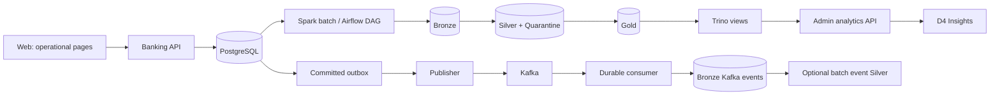

# Batch, stream and web integration review — 2026-11-02

## Actual data paths

Operational customer/admin/employee pages use PostgreSQL through the Banking API. They do not wait for Kafka, Spark or Trino before completing a banking transaction. Global Gold analytics is admin-only; employee reports remain branch-scoped PostgreSQL reports. Kafka events are for durable event ingestion/reconciliation, not direct browser push. The optional event Silver materialization does not replace PostgreSQL transaction snapshots or add another copy of a transaction to Gold facts.

## Findings and changes

1. **Services were stopped:** Kafka brokers, publisher, consumer, Spark and Airflow were stopped. Existing Gold was last written on 2026-10-26; the latest transaction/risk/review daily view data was 2026-09-29. Starting only MinIO/Hive/Trino reads an existing snapshot; it does not run ETL.
2. **Kafka cluster identity mismatch:** `.env` had a different `KAFKA_CLUSTER_ID` from all three existing volume `meta.properties`. Confirmed all volumes agreed and corrected only the configuration to their existing identity. No Kafka data or offsets were formatted/reset/deleted. The temporary test override uses 256 MiB broker heaps on the 6 GiB Docker host; normal compose still uses its default heap settings.
3. **Consumer could skip failed storage:** after a failed put/stat, the loop previously continued polling and could commit a later offset past the failed event. Storage/commit failure now exits for restart/replay. Auto offset storage is disabled. Invalid JSON/envelope is committed only after quarantine storage is verified. Replay object dates now come from the Kafka message timestamp rather than the consumer clock.
4. **Completed extraction could be overwritten on retry:** replaying the same batch after watermark commit could replace its original incremental Bronze delta with an empty/newer delta. Completed extraction manifests now freeze that batch. JDBC data is cached once so count, parquet write and candidate watermark refer to the same rows.
5. **Snapshots retained deleted/stale rows:** Silver previously merged every historical snapshot, retaining rows missing from a new complete snapshot. Snapshot datasets now read only the requested batch; append-only incremental sources continue reading historical Bronze.
6. **Financial DQ was incomplete:** equal debit/credit totals could still differ from the declared transaction amount, and some successes without transfer_request bypassed that check. All successful transactions now reconcile against their amount. Legitimate reversals with an existing successful original are distinguished from new transactions requiring a risk decision. DQ failure metrics are persisted before raising.
7. **Gold day keys used UTC after normalization:** transactions near Vietnam midnight could appear on the prior day. Calendar/time keys now use the configured business timezone; event timestamps remain normalized UTC.
8. **Trino initialization omitted web views:** registration now creates the 17 external tables and all six versioned analytics views. The DAG registers them after Gold DQ. Optional validated schema/bucket settings support isolated audit catalogs.
9. **Web filtering happened after LIMIT:** older selected dates could be missing from the latest 1,000 rows. The API now validates dates and filters them in Trino before LIMIT. Insights sends the range to the server, refreshes every minute and explains the batch/stream distinction. The 1,000-row coverage warning remains.
10. **Healthcheck used the wrong API route:** corrected to `/api/v1/health` and loads the project environment. Updated `running.md` with separate web, batch and stream startup instructions.

## Validation performed

### Full batch in isolated buckets

Ran all 20 configured source datasets against the existing PostgreSQL using real Spark, real MinIO and the candidate code. Used `d4-audit-batch-20261102-v2-*` buckets; published `gold` and its watermarks were untouched.

- Bronze validation passed for 20 sources.
- Silver DQ passed after quarantine: 1,780 invalid transaction records and their relevant dependent records were excluded; 224 posting records belonged to non-successful transactions. These counts overlap with child quarantine counts and must not be summed as independent transaction counts.
- Gold contains 10 dimensions and 7 facts. `fact_transaction`: **1,232 rows**; date coverage includes 2026-11-01. Gold grain/reference/risk checks passed.
- Repeating extraction after committed watermarks returned the exact completed extraction manifest, preserving raw input.
- Rebuilding Gold produced identical counts and passed Gold DQ again.
- Registered the candidate outputs under `hive.d4_audit_20261102_v2` and queried the fact and daily view successfully.
- `scripts/audit_spark_contracts.py` real-Spark assertions passed for Vietnam midnight date/time keys, a balanced-but-wrong-amount transaction, and a legitimate reversal.

Reproducible integration utility: `scripts/audit_pipeline.py`. It deliberately creates isolated audit buckets and never changes financial records. Audit objects/catalogs remain as evidence; the intermediate non-v2 audit catalog is not the final candidate.

### Stream

Started all three existing Kafka brokers with the preserved cluster identity, then publisher and consumer. The two existing pending outbox records were delivered. No financial transaction was created.

- Outbox: **508 PUBLISHED**, **0 PENDING/FAILED**.
- Consumer group: all three partitions **lag 0**.
- Latest two published event IDs found in actual recently written Bronze objects.
- Consumer restart followed by reconciliation preserved lag 0.
- Replayed three raw objects representing two event IDs into isolated event Silver; output was two unique events. Re-run had identical counts; no business transaction snapshot was changed.
- Unit tests cover storage failure, quarantine failure, correct put→stat→commit order and invalid envelopes.

Reconciliation utility: `scripts/audit_stream.py` (read-only, no offset reset/commit). Replay utility: `scripts/audit_event_merge.py` (writes only the validated `d4-audit-*` buckets).

### API and web

Rebuilt/recreated local Banking API; health is OK. All six real admin analytics requests succeeded:

| Dataset | Rows returned | Latest day in current published Gold |
| --- | ---: | --- |
| transactions | 871 | 2026-09-29 |
| risk | 132 | 2026-09-29 |
| reviews | 23 | 2026-09-29 |
| models | 3 | grouped by model, no day |
| logins | 294 | 2026-06-28 |
| loans | 52 | 2026-04-06 |

Valid date bounds returned only rows inside the range; invalid dates returned 400. Employee global analytics returned 403. Browser verification with mocked API data confirmed the date range is sent to the backend and the source explanation is visible. Frontend build and 38 unit tests passed; backend build and 17 applicable tests passed (the unrelated opt-in Redis OTP integration test was skipped in this run). Python suite: 23 passed, with 3 opt-in PostgreSQL financial-write tests skipped.

## Current state and limitations

- Kafka/publisher/consumer and Spark master/worker are now running. Existing PostgreSQL, Redis, API, MinIO, Hive, Trino and notification services remain running.
- Airflow DAG imports and dependency order were checked in its container image. **The scheduler/webserver were not started and no scheduled DAG execution/publication was performed.** Batch automation therefore remains off until the documented Airflow services are enabled.
- **Current web Gold is intentionally unchanged and still stale.** The fresh validated candidate is isolated. Do not describe this check as refreshing the live dashboard.
- Existing demo financial inconsistencies were quarantined only in audit data, not repaired or deleted from PostgreSQL.
- Current production Gold writer still overwrites table directories before its following Gold-DQ task completes. This review did not add atomic, versioned publication across all 17 tables; running live ETL can expose an in-progress snapshot. The isolated validation does not prove atomic production publication.
- Incremental extraction uses the configured timestamp/PK cursor. Extremely late commits carrying timestamps older than the committed watermark and physical deletions in incremental sources are not CDC and were not stress-tested here. Mutable source tables are configured as snapshots.
- The replay test covers event ID deduplication, not Kafka broker-loss/ISR fault injection. Retention had already expired most old Kafka records; this review did not recreate them from PUBLISHED rows.
- No emails, model training or full financial-write E2E utility were triggered.
